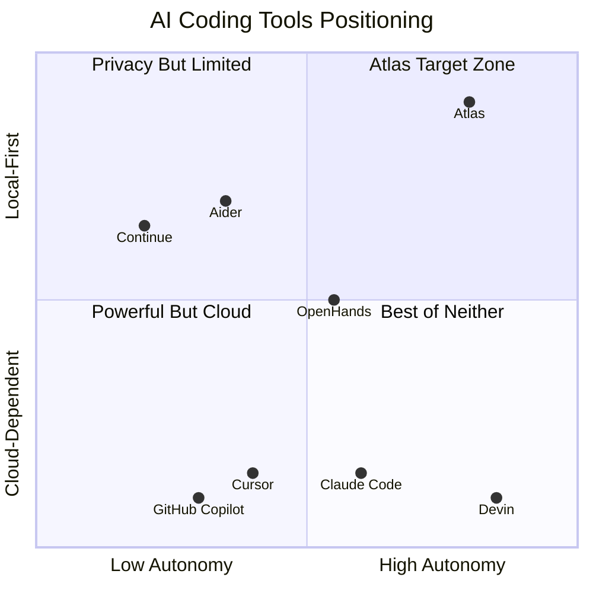

# Atlas AI Engineering System — Vision Document

> **Version:** 1.0.0  
> **Status:** ✅ Complete  
> **Last Updated:** 2026-07-14  
> **Owner:** Architecture Team  
> **ADR References:** [ADR-001](../appendix/adr/001-multi-agent-architecture.md), [ADR-006](../appendix/adr/006-local-first-design.md)

---

## Table of Contents

- [Mission Statement](#mission-statement)
- [Vision Statement](#vision-statement)
- [Problem Statement](#problem-statement)
- [Goals](#goals)
- [Non-Goals](#non-goals)
- [Success Criteria](#success-criteria)
- [Target Users](#target-users)
- [Competitive Landscape](#competitive-landscape)
- [Market Positioning](#market-positioning)
- [Competitive Advantages](#competitive-advantages)
- [Core Design Philosophy](#core-design-philosophy)
- [Future Roadmap](#future-roadmap)

---

## Mission Statement

**Build a completely local-first AI Software Engineering Platform powered by multiple specialized AI agents collaborating to design, build, test, debug, document, and improve software — autonomously, securely, and with enterprise-grade quality.**

Atlas is not a chatbot. It is not an autocomplete tool. It is an **autonomous engineering system** that thinks like a team of specialized engineers.

---

## Vision Statement

In 3 years, Atlas will be the platform that individual developers, teams, and enterprises use to turn ideas into production-grade software — without sending a single byte of code to the cloud, without depending on proprietary APIs, and without sacrificing quality for speed.

Atlas will demonstrate that **local AI can match or exceed cloud-dependent tools** in software engineering capability while providing absolute privacy, zero-latency operation, and full user sovereignty over code and data.

---

## Problem Statement

### The Current Landscape is Broken

1. **Cloud dependency creates risk.** GitHub Copilot, Cursor, and similar tools send proprietary code to external servers. For regulated industries (healthcare, finance, defense, government), this is a non-starter. Even for startups, IP leakage is an existential risk.

2. **Single-model systems hit ceilings.** Current AI coding tools use one model for everything. But software engineering requires diverse cognitive skills — planning is different from coding, which is different from debugging, which is different from security review. A single model cannot optimize for all.

3. **AI tools lack memory.** Every session starts from zero. The tool doesn't remember your architecture decisions, coding standards, previous bugs, preferred libraries, or project context. This forces developers to re-explain context constantly.

4. **AI tools don't collaborate.** No current tool models the way real engineering teams work — with specialists who hand off work, review each other, and build on shared context. AI assistants today are lone workers, not team members.

5. **No tool is truly autonomous.** Current tools assist; they don't engineer. They can't take a requirement, decompose it into tasks, plan the architecture, implement across multiple files, write tests, fix bugs, update documentation, and deliver a working feature — end to end.

### Atlas Solves This

Atlas replaces the cloud-dependent, single-model, memoryless, non-collaborative, assistant paradigm with a **local-first, multi-agent, memory-rich, collaborative, autonomous** engineering platform.

---

## Goals

### G1 — Autonomous Software Engineering

Atlas must be capable of taking a high-level requirement (e.g., "Build a REST API for user management with JWT auth") and autonomously:

- Decomposing it into tasks
- Planning the architecture
- Generating production-quality code across multiple files
- Writing tests
- Debugging failures
- Generating documentation
- Validating the result

### G2 — Multi-Agent Collaboration

The system must use specialized agents (Planner, Architect, Backend Engineer, Frontend Engineer, QA, Security, Documentation, etc.) that communicate, hand off work, and review each other — mimicking a high-performing engineering team.

### G3 — Local-First, Zero Cloud

All computation, inference, storage, and processing must happen on the user's machine. No data leaves the local environment. No external API calls are required for core functionality.

### G4 — Persistent Memory

Atlas must remember across sessions: architecture decisions, coding standards, previous bugs, project structure, developer preferences, and accumulated project knowledge. It must become smarter about your project over time.

### G5 — Enterprise-Grade Quality

Code quality, security, auditability, extensibility, and reliability must meet enterprise standards. This is not a prototype — it is a platform that organizations can depend on.

### G6 — Extensibility

The platform must support plugins, custom tools, additional AI models, and third-party integrations through well-defined extension points and a Plugin SDK.

### G7 — Cross-Platform

Atlas must run on Windows, macOS, and Linux without degradation in functionality.

### G8 — Developer Experience

The platform must be delightful to use. The UI must be modern, responsive, and intuitive. Setup must be minimal. The learning curve must be gentle.

---

## Non-Goals

These are explicitly out of scope for the current version:

| Non-Goal | Rationale |
|---|---|
| **Cloud execution** | Atlas is local-first by design. Cloud execution may be a future extension but is not a current goal. |
| **Multi-tenant SaaS** | Atlas is a single-user (or small team) platform, not a hosted service. Enterprise multi-tenancy is a future evolution. |
| **Training or fine-tuning models** | Atlas uses pre-trained models. Model training is out of scope. |
| **Replacing IDEs** | Atlas complements IDEs (VS Code, JetBrains, etc.). It does not replace them. Future IDE extensions are planned. |
| **Real-time collaboration** | Google Docs-style real-time multi-user editing is not a goal. |
| **Mobile application** | The primary interface is desktop. Mobile is a future consideration. |
| **General-purpose AI assistant** | Atlas is for software engineering only. It does not answer general knowledge questions, write essays, or perform non-engineering tasks. |
| **SSO/LDAP/OAuth** | Authentication complexity is deferred. Local-first means local auth is sufficient initially. |

---

## Success Criteria

### Quantitative

| Metric | Target | Measurement |
|---|---|---|
| **Task completion rate** | ≥ 80% of well-defined tasks completed autonomously | Automated evaluation suite |
| **Code compilation success** | ≥ 95% of generated code compiles without errors | CI pipeline metric |
| **Test pass rate** | ≥ 90% of generated tests pass on first run | CI pipeline metric |
| **Latency (planning)** | < 30 seconds for task decomposition | Telemetry |
| **Latency (code generation)** | < 60 seconds for a single file generation | Telemetry |
| **Memory retrieval accuracy** | ≥ 85% relevance in top-5 retrievals | Evaluation benchmark |
| **Startup time** | < 10 seconds to interactive UI | Manual benchmark |
| **Memory usage** | < 8 GB RAM (excluding model inference) | Resource monitoring |

### Qualitative

| Criterion | Description |
|---|---|
| **Developer satisfaction** | Developers should prefer Atlas for autonomous tasks over manual implementation |
| **Code quality** | Generated code should be indistinguishable from senior-engineer-written code |
| **Architecture coherence** | Multi-file changes should maintain architectural consistency |
| **Learning curve** | A developer should be productive within 30 minutes of first use |

---

## Target Users

### Primary

| User | Profile | Key Need |
|---|---|---|
| **Solo developer** | Individual building projects, freelancing, or learning | Multiply their output by 5-10x with AI-powered autonomous engineering |
| **Small team (2-10)** | Startup or small team with limited engineering resources | Get the output of a larger team without hiring |
| **Privacy-conscious developer** | Works on proprietary, regulated, or sensitive code | No code leaves local machine |

### Secondary

| User | Profile | Key Need |
|---|---|---|
| **Enterprise engineering team** | Team within a larger organization | Standardize AI-assisted development with full auditability |
| **Open-source maintainer** | Maintains OSS projects with limited time | Automate maintenance: bug triage, PR review, documentation |
| **Educator/Student** | Learning software engineering | See how an expert engineering team approaches problems |

### Excluded Users (for now)

| User | Why Excluded |
|---|---|
| Non-technical users | Atlas requires software engineering knowledge to evaluate and guide AI output |
| Data scientists (non-SWE) | Atlas is optimized for software engineering, not data analysis/ML training |

---

## Competitive Landscape

### Direct Competitors

| Product | Architecture | Strengths | Weaknesses |
|---|---|---|---|
| **GitHub Copilot** | Cloud, single-model | Deep IDE integration, massive training data, GitHub ecosystem | Cloud-only, no autonomy, no memory, single model, privacy concerns |
| **Cursor** | Cloud, single-model | Excellent UX, codebase-aware, multi-file editing | Cloud-dependent, proprietary, single model, limited autonomy |
| **Claude Code** | Cloud, single-model | Strong reasoning, terminal access, agentic capabilities | Cloud-only, single model, no persistent memory, Anthropic API dependency |
| **Devin (Cognition)** | Cloud, multi-step | Full autonomy, browser + terminal, impressive demos | Cloud-only, extremely expensive, closed-source, limited availability |
| **OpenHands** | Cloud/Local, multi-agent | Open-source, multi-agent, flexible architecture | Early stage, complex setup, inconsistent quality |
| **Aider** | Local/Cloud, single-model | Open-source, terminal-based, supports many models | Single model, no memory, no multi-agent, CLI only |
| **Continue** | Local/Cloud, single-model | Open-source, IDE extension, flexible model support | No autonomy, no memory, single-model paradigm |

### Indirect Competitors

| Product | Relevance |
|---|---|
| **ChatGPT / Claude (chat)** | Developers use them as coding assistants, but they lack project context and tooling |
| **JetBrains AI Assistant** | IDE-integrated, but cloud-dependent and limited in autonomy |
| **Amazon CodeWhisperer** | Enterprise-focused but cloud-only with limited capabilities |

---

## Market Positioning

**Atlas occupies the unique intersection of high autonomy AND local-first operation.** No competitor currently fills this space.

---

## Competitive Advantages

| Advantage | Description | Why It Matters |
|---|---|---|
| **Multi-Agent Architecture** | Specialized agents collaborate like a real engineering team | Better quality than single-model: each agent is optimized for its role |
| **Local-First** | Zero data leaves the machine | Regulatory compliance, IP protection, offline operation |
| **Persistent Memory** | Learns your project, preferences, and patterns over time | Gets smarter with use — unlike tools that start from zero every session |
| **Specialized Models** | Qwen3-Coder for coding, DeepSeek R1 for reasoning, BGE-M3 for retrieval | Each model plays to its strength instead of one model doing everything |
| **Open Architecture** | Plugin SDK, extensible tools, swappable models | Users can customize, extend, and contribute |
| **Cross-Platform** | Windows, macOS, Linux via Tauri | One platform, every OS |
| **Enterprise-Ready** | Audit logs, permission model, sandboxing, quality gates | Safe for regulated environments |
| **No Subscription** | No API costs, no monthly fees, no vendor lock-in | User owns their entire stack |

---

## Core Design Philosophy

### 1. Local-First Is Non-Negotiable

Every feature must work without an internet connection. Cloud integration may be offered as an optional enhancement in the future, but the core platform must be fully operational offline.

**Why:** Privacy, sovereignty, reliability, and the belief that developers should own their tools.

### 2. Agents Are Specialists, Not Generalists

Each agent has a defined role, clear boundaries, and a formal contract. Agents do one thing exceptionally well rather than everything mediocrely.

**Why:** This mirrors how high-performing engineering teams work. A security engineer doesn't write frontend code. A QA engineer doesn't make architecture decisions.

### 3. Memory Is a First-Class Citizen

Memory is not an afterthought. It is a core architectural component with dedicated storage, retrieval optimization, and lifecycle management.

**Why:** Without memory, every interaction starts from zero. Memory is what transforms Atlas from a tool into a team member.

### 4. Quality Over Speed

Atlas will never sacrifice code quality for generation speed. A correct, well-structured, well-tested solution delivered in 60 seconds is superior to a buggy, poorly-structured solution delivered in 10 seconds.

**Why:** The cost of fixing bad code always exceeds the cost of generating good code.

### 5. Extensibility Is Architecture

Plugin support, custom tools, and model swapping are not features to be bolted on later. They are architectural requirements that shape every design decision from day one.

**Why:** The best platforms are those that their users can extend. VS Code won because of extensions. Atlas must learn from this.

### 6. Transparency Is Trust

Every AI decision, every reasoning step, every tool invocation must be observable and explainable. Users must be able to understand why Atlas did what it did.

**Why:** Trust requires transparency. Developers will not adopt a tool that makes opaque, unexplainable decisions about their codebase.

---

## Future Roadmap

### Phase 1 — Foundation (Months 1-4)

Core platform with essential agents (Planner, Architect, Backend Engineer, QA), basic memory, file system tools, and a minimal desktop UI.

**Milestone:** Atlas can autonomously implement a simple CRUD API from a natural language requirement.

### Phase 2 — Intelligence (Months 5-8)

Full agent roster, advanced memory with knowledge graph, RAG pipeline, repository intelligence, and a polished desktop application.

**Milestone:** Atlas can implement a multi-file feature across frontend and backend with tests and documentation.

### Phase 3 — Maturity (Months 9-12)

Plugin SDK, advanced tooling (Docker, browser automation), AI evaluation framework, observability dashboards, and enterprise features (audit logs, permission model).

**Milestone:** Atlas can be deployed in an enterprise environment with full auditability and customization.

### Phase 4 — Ecosystem (Months 13-18)

Plugin marketplace, IDE extensions (VS Code, JetBrains), community contributions, optional cloud execution, and distributed agent support.

**Milestone:** Third-party developers are building and distributing Atlas plugins.

### Phase 5 — Evolution (Months 19-24+)

Voice interaction, GUI automation, federated AI (multiple machines), custom model training support, and enterprise federation.

**Milestone:** Atlas is recognized as a leading AI engineering platform.

---

## Naming

The name "Atlas" is a working name. The architecture explicitly supports renaming through a single configuration constant (`PRODUCT_NAME`). All internal references use this constant rather than hardcoded strings.

**Name rationale:** In Greek mythology, Atlas holds up the world. In engineering, Atlas holds up the project — bearing the weight of implementation so the developer can focus on design and direction.

---

*This document establishes the "why" of Atlas. For the "what," see the [PRD](../02-prd/prd.md). For the "how," see the [System Architecture](../03-architecture/system-architecture.md).*
