# Atlas AI Engineering System — Product Requirements Document

> **Version:** 1.0.0  
> **Status:** ✅ Complete  
> **Last Updated:** 2026-07-14  
> **Owner:** Product & Architecture Team  
> **ADR References:** [ADR-001](../appendix/adr/001-multi-agent-architecture.md), [ADR-002](../appendix/adr/002-why-three-models.md), [ADR-006](../appendix/adr/006-local-first-design.md)  
> **Upstream:** [Vision](../01-vision/vision.md)

---

## Table of Contents

- [Functional Requirements](#functional-requirements)
- [Non-Functional Requirements](#non-functional-requirements)
- [Performance Targets](#performance-targets)
- [Scalability Targets](#scalability-targets)
- [Security Requirements](#security-requirements)
- [User Stories](#user-stories)
- [Acceptance Criteria](#acceptance-criteria)
- [Risk Analysis](#risk-analysis)
- [Constraints](#constraints)
- [Assumptions](#assumptions)
- [Dependencies](#dependencies)

---

## Functional Requirements

### FR-100: Project Management

| ID | Requirement | Priority | Notes |
|---|---|---|---|
| FR-101 | Users must be able to create, open, and switch between projects | P0 | Core UX flow |
| FR-102 | Each project must have an isolated workspace with its own memory, configuration, and history | P0 | Prevents cross-contamination |
| FR-103 | Projects must support linking to existing Git repositories | P0 | Most users will have existing repos |
| FR-104 | Projects must persist across application restarts | P0 | Stateful application |
| FR-105 | Users must be able to archive and delete projects | P1 | Lifecycle management |
| FR-106 | Projects must support configuration files (`.atlas.toml`) for project-specific settings | P1 | Customization per project |

### FR-200: Task Management

| ID | Requirement | Priority | Notes |
|---|---|---|---|
| FR-201 | Users must be able to submit tasks in natural language | P0 | Primary input method |
| FR-202 | The system must decompose tasks into subtasks automatically | P0 | Core autonomous capability |
| FR-203 | Users must be able to view task progress in real-time | P0 | Transparency requirement |
| FR-204 | Users must be able to approve, reject, or modify task plans before execution | P0 | Human-in-the-loop |
| FR-205 | Users must be able to pause, resume, and cancel tasks | P0 | Control requirement |
| FR-206 | The system must maintain a task history with full audit trail | P1 | Auditability |
| FR-207 | Tasks must support priority levels (critical, high, normal, low) | P1 | Scheduling optimization |
| FR-208 | The system must estimate task duration before execution | P2 | UX improvement |

### FR-300: AI Agent System

| ID | Requirement | Priority | Notes |
|---|---|---|---|
| FR-301 | The system must support at least 15 specialized AI agents | P0 | See [Agent Architecture](../03-architecture/agent-architecture.md) |
| FR-302 | Agents must be independently configurable | P0 | Different models, prompts, permissions |
| FR-303 | Agents must communicate through a defined protocol | P0 | See [Communication Protocol](../03-architecture/communication-protocol.md) |
| FR-304 | Agent outputs must be reviewable before committing changes | P0 | Human-in-the-loop |
| FR-305 | The system must support parallel agent execution where tasks are independent | P1 | Performance |
| FR-306 | Agent failures must not crash the system | P0 | Reliability |
| FR-307 | Users must be able to see which agent is performing which action | P0 | Transparency |
| FR-308 | Users must be able to override agent decisions | P1 | User sovereignty |

### FR-400: Code Generation

| ID | Requirement | Priority | Notes |
|---|---|---|---|
| FR-401 | The system must generate code in any mainstream programming language | P0 | Language-agnostic |
| FR-402 | Generated code must follow the project's existing coding standards | P0 | Consistency |
| FR-403 | The system must generate multi-file changes atomically | P0 | Architectural consistency |
| FR-404 | Generated code must include appropriate error handling | P0 | Quality |
| FR-405 | The system must generate unit tests alongside implementation code | P0 | Test-driven quality |
| FR-406 | Generated code must include inline documentation | P1 | Maintainability |
| FR-407 | The system must apply existing linting and formatting rules | P1 | Standards compliance |
| FR-408 | The system must support code refactoring tasks | P1 | Beyond generation |

### FR-500: Memory & Learning

| ID | Requirement | Priority | Notes |
|---|---|---|---|
| FR-501 | The system must persist project memory across sessions | P0 | Core differentiation |
| FR-502 | The system must learn and apply project-specific coding standards | P0 | Adaptive quality |
| FR-503 | The system must remember architecture decisions and apply them consistently | P0 | Coherence |
| FR-504 | The system must remember previous bugs and avoid repeating them | P1 | Learning loop |
| FR-505 | Users must be able to view and edit stored memories | P1 | Transparency, correction |
| FR-506 | The system must automatically prune outdated memories | P2 | Memory hygiene |
| FR-507 | Memory retrieval must be contextually relevant | P0 | Quality retrieval |

### FR-600: Repository Intelligence

| ID | Requirement | Priority | Notes |
|---|---|---|---|
| FR-601 | The system must index and understand the full repository structure | P0 | Context awareness |
| FR-602 | The system must parse and understand code at the AST level | P0 | Semantic understanding |
| FR-603 | The system must build dependency graphs | P1 | Impact analysis |
| FR-604 | The system must support semantic code search | P0 | Developer productivity |
| FR-605 | The system must track symbol references across files | P1 | Refactoring support |
| FR-606 | The system must understand import/export relationships | P1 | Module boundaries |

### FR-700: Tooling

| ID | Requirement | Priority | Notes |
|---|---|---|---|
| FR-701 | The system must execute terminal commands in a sandboxed environment | P0 | Safety + capability |
| FR-702 | The system must support Git operations (commit, branch, diff, etc.) | P0 | Version control |
| FR-703 | The system must read and write files with undo capability | P0 | Core operation |
| FR-704 | The system must support package manager operations (npm, pip, cargo, etc.) | P1 | Dependency management |
| FR-705 | The system must support Docker operations | P2 | Container support |
| FR-706 | The system must support linter and formatter execution | P1 | Quality enforcement |
| FR-707 | The system must support test runner execution | P0 | Validation |
| FR-708 | All tool invocations must be logged and auditable | P0 | Security, debugging |

### FR-800: User Interface

| ID | Requirement | Priority | Notes |
|---|---|---|---|
| FR-801 | The system must provide a desktop application | P0 | Primary interface |
| FR-802 | The system must provide a real-time task progress view | P0 | Transparency |
| FR-803 | The system must provide a conversational interface for task submission | P0 | Natural interaction |
| FR-804 | The system must provide a file diff view for code changes | P0 | Review capability |
| FR-805 | The system must provide a memory browser | P1 | Transparency |
| FR-806 | The system must provide an agent activity dashboard | P1 | Monitoring |
| FR-807 | The system must support dark mode | P0 | Developer preference |
| FR-808 | The system must provide keyboard shortcuts for common actions | P1 | Power users |
| FR-809 | The system must provide a web interface as an alternative | P2 | Flexibility |

### FR-900: Plugin System

| ID | Requirement | Priority | Notes |
|---|---|---|---|
| FR-901 | The system must support loading third-party plugins | P1 | Extensibility |
| FR-902 | Plugins must declare their required permissions | P0 | Security |
| FR-903 | Plugins must run in a sandboxed environment | P0 | Safety |
| FR-904 | The system must provide a Plugin SDK with documentation | P1 | Developer experience |
| FR-905 | Plugins must be able to register custom tools | P1 | Extensibility |
| FR-906 | Plugins must be versionable and updatable | P2 | Lifecycle |

---

## Non-Functional Requirements

### NFR-100: Performance

| ID | Requirement | Target | Measurement |
|---|---|---|---|
| NFR-101 | Application startup time | < 10 seconds | Cold start to interactive UI |
| NFR-102 | Task decomposition latency | < 30 seconds | User submits → plan displayed |
| NFR-103 | Single file code generation | < 60 seconds | Plan → generated file |
| NFR-104 | Memory retrieval latency | < 2 seconds | Query → results |
| NFR-105 | Repository indexing (10K files) | < 5 minutes | Initial full index |
| NFR-106 | Incremental re-indexing | < 10 seconds | File change → index updated |
| NFR-107 | UI interaction latency | < 100ms | Click → visual response |
| NFR-108 | Semantic search results | < 3 seconds | Query → ranked results |

### NFR-200: Resource Usage

| ID | Requirement | Target | Notes |
|---|---|---|---|
| NFR-201 | RAM usage (platform, excluding models) | < 4 GB | Core platform footprint |
| NFR-202 | RAM usage (with models loaded) | < 16 GB | All three models active |
| NFR-203 | Disk usage (platform) | < 2 GB | Installed size |
| NFR-204 | Disk usage (per project memory) | < 500 MB | Typical project |
| NFR-205 | CPU usage at idle | < 5% | No active tasks |
| NFR-206 | GPU memory (Qwen3-Coder) | Configurable | Support quantization levels |
| NFR-207 | GPU memory (DeepSeek R1) | Configurable | Support quantization levels |

### NFR-300: Reliability

| ID | Requirement | Target | Notes |
|---|---|---|---|
| NFR-301 | Agent crash isolation | Agent crash must not affect other agents or the system | Process/thread isolation |
| NFR-302 | Task recovery | Failed tasks must be recoverable from last checkpoint | Checkpointing required |
| NFR-303 | Data durability | Zero data loss under normal operation | WAL, journaling |
| NFR-304 | Graceful degradation | If one model is unavailable, remaining functionality must work | Fallback strategies |
| NFR-305 | Startup recovery | Application must recover from unclean shutdown | State persistence |

### NFR-400: Security

| ID | Requirement | Target | Notes |
|---|---|---|---|
| NFR-401 | Command sandboxing | All terminal commands must execute in a restricted sandbox | Prevent system damage |
| NFR-402 | File system protection | Agents cannot access files outside the project directory | Path validation |
| NFR-403 | No network access by default | AI agents cannot make network requests unless explicitly permitted | Privacy |
| NFR-404 | Secrets protection | No secret/credential data included in AI prompts | Redaction required |
| NFR-405 | Audit logging | All agent actions must be logged with timestamps | Compliance |
| NFR-406 | Plugin sandboxing | Plugins must run with minimal permissions | Defense in depth |

### NFR-500: Usability

| ID | Requirement | Target | Notes |
|---|---|---|---|
| NFR-501 | Time to first task | < 5 minutes from install | Minimal setup |
| NFR-502 | Learning curve | Productive within 30 minutes | Intuitive UX |
| NFR-503 | Accessibility | WCAG 2.1 AA compliance | Inclusive design |
| NFR-504 | Internationalization | English first, i18n-ready architecture | Future localization |
| NFR-505 | Cross-platform consistency | Same UX on Windows, macOS, Linux | Tauri ensures this |

### NFR-600: Maintainability

| ID | Requirement | Target | Notes |
|---|---|---|---|
| NFR-601 | Code coverage | > 80% for core modules | Automated enforcement |
| NFR-602 | Documentation coverage | Every public API documented | Living documentation |
| NFR-603 | Modular architecture | Any component replaceable independently | Clean boundaries |
| NFR-604 | Dependency management | Minimal, audited dependencies | Supply chain security |

---

## Performance Targets

```mermaid
gantt
    title Typical Task Execution Timeline
    dateFormat ss
    axisFormat %S sec

    section User Input
    Submit task                          :done, 00, 01
    
    section Planning
    Task decomposition (DeepSeek R1)     :active, 01, 15
    Plan review by user                  :15, 25
    
    section Execution
    Architecture design                  :25, 40
    Code generation (Qwen3-Coder)        :40, 80
    Test generation                      :80, 100
    
    section Validation
    Run tests                            :100, 115
    Fix failures (if any)               :115, 140
    Final review                         :140, 155
    
    section Delivery
    Present diff for approval            :155, 160
```



| Scenario | Target | Acceptable | Unacceptable |
|---|---|---|---|
| Simple function generation | < 15 seconds | < 30 seconds | > 60 seconds |
| Multi-file feature | < 3 minutes | < 5 minutes | > 10 minutes |
| Full CRUD endpoint | < 5 minutes | < 8 minutes | > 15 minutes |
| Repository indexing (10K files) | < 3 minutes | < 5 minutes | > 10 minutes |
| Semantic search | < 1 second | < 3 seconds | > 5 seconds |
| Memory retrieval | < 500ms | < 2 seconds | > 5 seconds |

---

## Scalability Targets

| Dimension | Target | Notes |
|---|---|---|
| Repository size | Up to 100K files | Beyond this, incremental indexing becomes critical |
| Project memory | Up to 10K memory entries per project | With pruning and relevance scoring |
| Concurrent agents | Up to 8 agents executing in parallel | Hardware dependent |
| Task queue depth | Up to 100 queued tasks | With priority ordering |
| Conversation history | Up to 1M tokens across sessions | With summarization and archival |
| Plugin count | Up to 50 loaded plugins | Resource limits per plugin |

---

## Security Requirements

See [Security Architecture](../04-subsystems/security-architecture.md) for full details.

| ID | Requirement | Category |
|---|---|---|
| SEC-01 | All AI-executed commands must run in a sandbox | Execution Safety |
| SEC-02 | File system access must be restricted to the project directory tree | Data Protection |
| SEC-03 | No code or data may be transmitted to external servers | Privacy |
| SEC-04 | Secrets detected in code must be redacted from AI prompts | Secret Protection |
| SEC-05 | All agent actions must be logged with full context | Auditability |
| SEC-06 | Dangerous commands (rm -rf, format, etc.) must require user confirmation | Destructive Action Prevention |
| SEC-07 | Plugins must declare and adhere to permission manifests | Plugin Safety |
| SEC-08 | Model inference must be isolated from system processes | Process Isolation |
| SEC-09 | Prompt injection attacks must be mitigated | AI Safety |
| SEC-10 | The application must not run as root/administrator | Privilege Minimization |

---

## User Stories

### Epic 1: Project Setup

```
US-101: As a developer, I want to create a new Atlas project linked to my existing Git repository,
        so that Atlas can understand my codebase and start helping me.

        Acceptance Criteria:
        - I can select a local directory containing a Git repository
        - Atlas indexes the repository within 5 minutes
        - I can see repository statistics (files, languages, size)
        - Atlas identifies the project's tech stack automatically

US-102: As a developer, I want Atlas to automatically detect my project's coding standards
        (linting rules, formatting, naming conventions),
        so that generated code follows my existing patterns.

        Acceptance Criteria:
        - Atlas detects .eslintrc, .prettierrc, rustfmt.toml, pyproject.toml, etc.
        - Generated code follows detected standards
        - I can manually override detected standards

US-103: As a developer, I want to configure project-specific settings in a .atlas.toml file,
        so that I can customize Atlas behavior per project.

        Acceptance Criteria:
        - Atlas reads .atlas.toml from the project root
        - Settings include: excluded paths, custom tools, memory preferences
        - Invalid configuration produces clear error messages
```

### Epic 2: Autonomous Task Execution

```
US-201: As a developer, I want to describe a feature in natural language
        and have Atlas implement it autonomously,
        so that I can focus on design decisions instead of implementation details.

        Acceptance Criteria:
        - I type a task description (e.g., "Add JWT authentication to the user API")
        - Atlas decomposes the task into subtasks
        - I can review and approve the plan before execution
        - Atlas implements the feature across multiple files
        - Atlas writes tests for the new code
        - I can review the complete diff before accepting

US-202: As a developer, I want to see real-time progress of task execution,
        so that I know what Atlas is doing and can intervene if needed.

        Acceptance Criteria:
        - I can see which agent is active
        - I can see what each agent is doing
        - I can see estimated time remaining
        - I can pause execution at any point
        - I can cancel execution and rollback changes

US-203: As a developer, I want Atlas to automatically fix failing tests,
        so that I don't have to debug AI-generated code manually.

        Acceptance Criteria:
        - Atlas runs tests after code generation
        - If tests fail, Atlas analyzes the failure using DeepSeek R1
        - Atlas attempts to fix the code (up to 3 retries)
        - If unable to fix, Atlas reports the issue with root cause analysis
```

### Epic 3: Code Review & Quality

```
US-301: As a developer, I want Atlas to review my code changes,
        so that I get the quality of a senior engineer code review.

        Acceptance Criteria:
        - I can submit code for review (file, diff, or PR)
        - Atlas reviews for: bugs, security issues, performance, style, best practices
        - Review comments are specific and actionable
        - Review suggests fixes, not just problems

US-302: As a developer, I want Atlas to refactor my code,
        so that I can improve code quality without manual effort.

        Acceptance Criteria:
        - I can select code and request refactoring
        - Atlas explains what it wants to change and why
        - I can approve or reject each proposed change
        - Refactoring preserves behavior (verified by tests)
```

### Epic 4: Memory & Learning

```
US-401: As a developer, I want Atlas to remember my architecture decisions,
        so that future code generation is consistent with past decisions.

        Acceptance Criteria:
        - When I make an architecture decision, Atlas stores it
        - Future code generation references stored decisions
        - I can view all stored architecture decisions
        - I can update or delete stored decisions

US-402: As a developer, I want Atlas to learn from my code review feedback,
        so that it doesn't make the same mistakes twice.

        Acceptance Criteria:
        - When I reject code and provide feedback, Atlas stores the lesson
        - Future code generation avoids the rejected pattern
        - I can see what Atlas has learned from my feedback
```

### Epic 5: Security & Trust

```
US-501: As a developer working on proprietary code,
        I want to verify that no code leaves my machine,
        so that I can trust Atlas with sensitive projects.

        Acceptance Criteria:
        - Network activity monitor shows zero external connections during operation
        - All AI inference happens locally
        - All storage is local
        - Audit log confirms no external data transmission

US-502: As a developer, I want to review and approve every command
        Atlas wants to execute on my system,
        so that I maintain control over my environment.

        Acceptance Criteria:
        - Potentially destructive commands require explicit approval
        - I can configure auto-approve for safe commands (read-only)
        - All commands are logged with full context
        - I can set a "restricted mode" that requires approval for everything
```

### Epic 6: Plugin Ecosystem

```
US-601: As a plugin developer, I want to create a custom tool for Atlas,
        so that I can extend its capabilities for my specific workflow.

        Acceptance Criteria:
        - Plugin SDK provides clear documentation and examples
        - I can register new tools that agents can invoke
        - Plugins declare their permissions in a manifest
        - I can test plugins locally before distribution

US-602: As a developer, I want to install plugins from a marketplace,
        so that I can add capabilities without writing code.

        Acceptance Criteria:
        - I can browse available plugins
        - I can install plugins with one click
        - Plugins are sandboxed and permission-gated
        - I can uninstall plugins cleanly
```

---

## Risk Analysis

### Technical Risks

| ID | Risk | Probability | Impact | Mitigation |
|---|---|---|---|---|
| TR-01 | **Model quality insufficient for production code** | Medium | Critical | Benchmark-driven model selection; support model swapping; evaluation framework catches quality regression |
| TR-02 | **Local GPU memory insufficient for three models** | High | High | Support quantization (GGUF Q4/Q5/Q8); model swapping (load/unload); CPU fallback for smaller models |
| TR-03 | **Multi-agent coordination deadlocks** | Medium | High | Timeout-based deadlock detection; execution engine state machine; automatic recovery |
| TR-04 | **Repository indexing too slow for large repos** | Medium | Medium | Incremental indexing; file-watch-based updates; parallel indexing; chunked processing |
| TR-05 | **Memory system grows unbounded** | Medium | Medium | Automatic pruning policies; relevance scoring; storage limits per project |
| TR-06 | **Prompt injection via repository content** | Medium | High | Input sanitization; prompt/data separation; sandboxed execution; output validation |
| TR-07 | **Cross-platform compatibility issues** | Low | Medium | Tauri abstracts OS differences; CI testing on all three platforms; platform-specific adapters |
| TR-08 | **Rust-Python interop complexity** | Medium | Medium | Clear FFI boundaries via PyO3; gRPC fallback; well-defined protocol buffers |

### Product Risks

| ID | Risk | Probability | Impact | Mitigation |
|---|---|---|---|---|
| PR-01 | **Users don't trust autonomous code generation** | High | Critical | Human-in-the-loop approval at every stage; full transparency; undo capability |
| PR-02 | **Setup complexity deters users** | Medium | High | One-click installer; minimal configuration; sensible defaults; guided onboarding |
| PR-03 | **Local model quality perception vs. cloud models** | High | High | Benchmark comparisons; quality-focused prompting; specialized model selection |
| PR-04 | **Hardware requirements too high** | High | Medium | Tiered experience (CPU-only mode, single GPU, multi-GPU); progressive capability |

### Operational Risks

| ID | Risk | Probability | Impact | Mitigation |
|---|---|---|---|---|
| OR-01 | **Model updates break existing prompts** | Medium | High | Prompt versioning; regression test suite; model adapter abstraction |
| OR-02 | **Community adoption slower than expected** | Medium | Medium | Strong documentation; example projects; video tutorials; active community support |

---

## Constraints

| Constraint | Description | Impact |
|---|---|---|
| **Three fixed models** | Qwen3-Coder, DeepSeek R1, BAAI BGE-M3 are the only models | Architecture must maximize collaboration between exactly these three |
| **Local-only** | No cloud services for core functionality | Must handle all computation, storage, and inference locally |
| **Cross-platform** | Windows, macOS, Linux support required | Technology choices must work on all three platforms |
| **Single-user** | Initially designed for individual developers | Multi-user is a future evolution, not a current constraint |
| **Open architecture** | Must support future extensibility | Cannot use closed or proprietary internal formats |

---

## Assumptions

| Assumption | Risk if Wrong | Mitigation |
|---|---|---|
| Users have a GPU with ≥ 8GB VRAM | CPU-only mode is too slow for practical use | Support quantized models; provide CPU fallback with reduced capabilities |
| Users have ≥ 16GB system RAM | Platform cannot load three models | Model swapping (only load active model); reduce platform memory footprint |
| Users have ≥ 50GB free disk space | Cannot store models + indices + memory | Clear disk usage reporting; configurable storage limits |
| Qwen3-Coder produces production-quality code | Core value proposition fails | Evaluation framework catches quality issues; model swapping architecture |
| DeepSeek R1 produces reliable reasoning | Planning and review quality suffers | Validation steps; human review checkpoints; reasoning evaluation |
| BGE-M3 provides accurate embeddings | Retrieval quality degrades | Re-ranking layer; multiple retrieval strategies; evaluation benchmarks |

---

## Dependencies

| Dependency | Type | Risk | Notes |
|---|---|---|---|
| **Ollama** | Runtime | Medium | Primary inference server; must abstract to support alternatives |
| **Tauri** | Framework | Low | Mature, well-maintained; Rust ecosystem alignment |
| **Qdrant** | Database | Low | Can run embedded; Rust client available |
| **PostgreSQL** | Database | Low | Industry standard; SQLite fallback for simple deployments |
| **Tree-sitter** | Library | Low | Industry standard; comprehensive language support |
| **NATS** | Messaging | Medium | Can start with in-process alternative; migrate to NATS when needed |
| **React** | Framework | Low | Dominant ecosystem; large talent pool |
| **OpenTelemetry** | Observability | Low | Vendor-neutral standard; wide adoption |

---

*This PRD defines the "what" of Atlas. For the "why," see the [Vision](../01-vision/vision.md). For the "how," see the [System Architecture](../03-architecture/system-architecture.md).*
