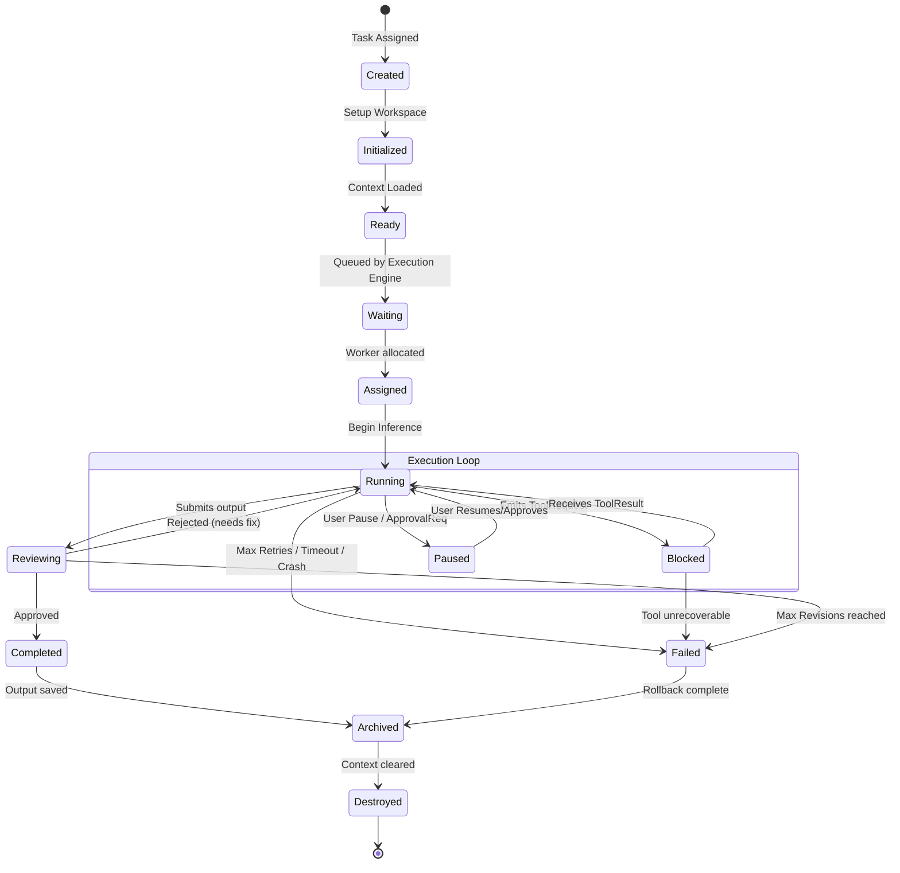

# Agent Lifecycle State Machine

> **Version:** 1.0.0  
> **Status:** 🚧 Draft  
> **Last Updated:** 2026-07-14  
> **Owner:** AI Team  
> **Upstream:** [System Architecture](system-architecture.md), [Execution Engine](execution-engine.md)

---

## Purpose

Agents in Atlas are not simple functions that are called and return a value. They are persistent state machines that manage their own context, yield execution when blocked, handle timeouts, and undergo reviews.

This document defines the strict lifecycle states of an Agent instance as it processes a Subtask. The Orchestrator and Execution Engine rely on this state machine to route events and manage resources.

---

## Lifecycle State Machine

---

## State Definitions

| State | Description | Allowed Transitions |
|---|---|---|
| **Created** | The agent instance is instantiated in memory with its Profile. | `Initialized` |
| **Initialized** | The sandbox is prepared, and basic validation passes. | `Ready` |
| **Ready** | The necessary context (Task Memory, Architecture Memory) is fetched and injected into the prompt. | `Waiting` |
| **Waiting** | The agent is placed in the `queue.agent.[type]` pending a worker thread. | `Assigned` |
| **Assigned** | The Execution Engine assigns a worker thread to the agent. | `Running` |
| **Running** | The agent is actively querying the Inference Server (LLM) or streaming tokens. | `Blocked`, `Paused`, `Reviewing`, `Failed` |
| **Blocked** | The agent has emitted a `ToolRequest` (e.g., waiting for grep, AST parse, or compilation) and yielded the thread. | `Running`, `Failed` |
| **Paused** | Execution is halted (by User clicking pause, or Approval Manager intercepting a dangerous command). | `Running`, `Failed` |
| **Reviewing** | The agent believes it has finished the subtask and has emitted a `ReviewRequest` to the Code Review agent. | `Completed`, `Running`, `Failed` |
| **Completed** | The reviewer approved the output. The DAG Runner marks this node done. | `Archived` |
| **Failed** | A fatal error occurred (timeout, sandbox breach, max retries hit). Triggers Rollback Manager. | `Archived` |
| **Archived** | Terminal state. Execution logs and outputs are flushed to the Database/Event Bus. | `Destroyed` |
| **Destroyed** | The process/object is killed, freeing RAM/VRAM. | `None` |

---

## Transition Mechanics

State transitions are **not** managed by the agent itself. They are managed by the Execution Engine Worker reacting to events over the NATS bus.

For example, an agent cannot put itself into the `Completed` state. It can only emit a `ReviewRequest` event. The Execution Engine puts the agent into the `Reviewing` state. When the Review Agent emits a `ReviewApproved` event, the Engine transitions the original agent to `Completed`.

This separation of concerns prevents a hallucinating LLM from marking a failed task as completed.

---

## Failure & Recovery Paths

### 1. The Crash Loop (Running → Failed)
**Scenario:** The agent continuously generates invalid JSON or fails to adhere to its schema.
**Recovery:** The Python AI Runtime tracks parsing failures. After `max_retries` (default: 3), it emits a `TaskFailedEvent` with the traceback. The Execution Engine transitions the agent to `Failed` and initiates a rollback.

### 2. The Tool Timeout (Blocked → Failed)
**Scenario:** The agent runs `npm install` but the package registry is down, hanging indefinitely.
**Recovery:** The Timeout Manager monitors the `Blocked` state. If the tool SLA is breached, it kills the subprocess, emits a `ToolResult(Timeout)`, transitions the agent to `Running` so the agent knows it failed, and allows the agent to try a different approach. If the overall Task SLA is breached, it transitions to `Failed`.

### 3. The Revision Loop (Reviewing → Running)
**Scenario:** The agent writes code that fails the test suite during the `Reviewing` phase.
**Recovery:** The Execution Engine transitions the agent back to `Running`, injecting the test failures into its context window, and prompts it to fix the errors. This is hard-capped (default: 3 revisions) to prevent infinite loops, after which it transitions to `Failed`.

---

## Traceability

- Implements [FR-205 (Pause/Resume/Cancel Tasks)](../02-prd/prd.md).
- Fulfills [EP-05 (Fail Safe)](../08-governance/engineering-principles.md) via strict state constraints and rollback paths.
- Relies on [AP-03 (Event-Driven Communication)](../08-governance/architecture-principles.md) for all state transitions.
