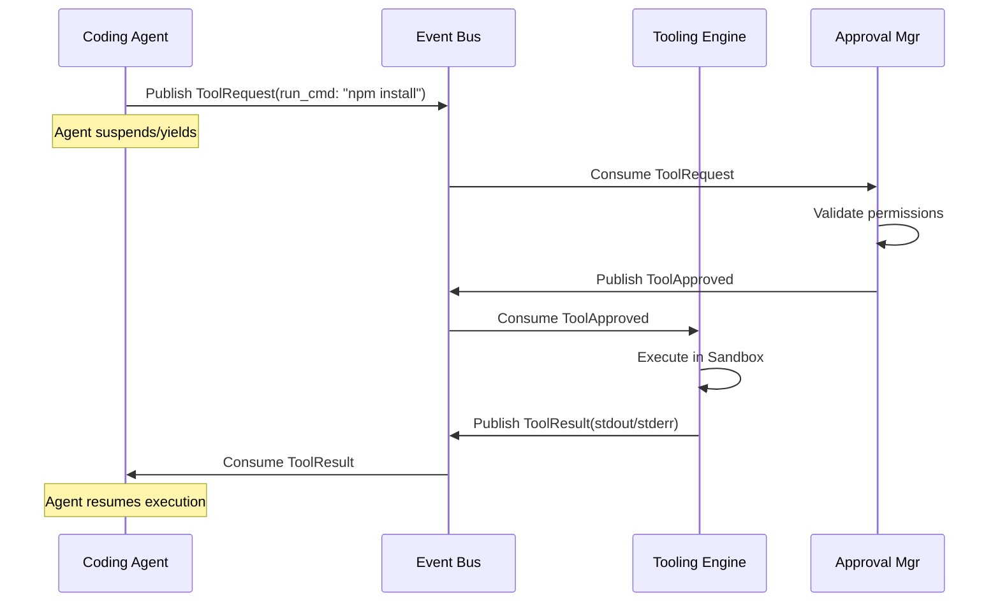

# Agent Communication Protocol

> **Version:** 1.0.0  
> **Status:** 🚧 Draft  
> **Last Updated:** 2026-07-14  
> **Owner:** Architecture Team  
> **Upstream:** [Orchestrator Design](orchestrator-design.md)

---

## Purpose

In a multi-agent system, the format and rules governing how agents communicate are as critical as the models themselves. The Agent Communication Protocol defines the message schemas, tracing, priorities, and lifecycles of all messages passed over the NATS Event Bus.

This protocol ensures that agents can be rewritten, replaced, or distributed without breaking the system.

---

## Message Envelope Schema

Every event/message uses a standardized envelope. The payload varies by event type, but the envelope is immutable.

```json
{
  "id": "msg_01h4j...",              // ULID for strict ordering and uniqueness
  "type": "atlas.agent.tool_req",    // Topic routing key
  "version": "1.0",                  // Schema version
  "source": "agent_frontend_coder",  // Component that emitted this
  "timestamp": "2026-07-14T10:00:00Z",
  
  "tracing": {
    "correlation_id": "corr_abc123", // Links all messages in a user request flow
    "session_id": "sess_xyz789",     // The active user session
    "task_id": "task_456def",        // The specific task being executed
    "parent_id": "msg_01h4i..."      // The message that triggered this one
  },
  
  "metadata": {
    "priority": 1,                   // 0=Critical, 1=High, 2=Normal, 3=Low
    "ttl_seconds": 300,              // When the message should be dead-lettered
    "retry_count": 0                 // Number of times this has been retried
  },
  
  "payload": {                       // Event-specific data
    "tool_name": "write_file",
    "args": { ... }
  }
}
```

---

## Tracing & Observability

Atlas uses distributed tracing concepts natively.

1. **Correlation ID:** Generated when the UI submits a command. Every subsequent subtask, agent thought, tool invocation, and DB write carries this ID. This allows the UI to construct a perfect timeline of "What happened when I clicked Submit?"
2. **Parent ID:** Establishes causality. If an agent emits a `ToolRequest`, the resulting `ToolResult` will have the request's ID as its `parent_id`.
3. **Session ID:** Secures message access. Agents can only access memory scoped to the `session_id` in the message envelope.

---

## Message Lifecycles & Delivery Guarantees

### ACK / NACK Semantics
- Consumers **must** ACK (Acknowledge) a message once successfully processed.
- Consumers **must** NACK (Negative Acknowledge) if a transient error occurs (e.g., DB locked). This tells the Orchestrator to immediately re-queue the message.
- If a consumer crashes without ACKing, the NATS JetStream visibility timeout expires, and the message is re-delivered.

### Retries & Exponential Backoff
If a message is NACKed or times out, the Retry Manager takes over.
- Retry 1: 2 seconds
- Retry 2: 4 seconds
- Retry 3: 8 seconds
- Failure: Message is stripped from the active queue and moved to the **Dead-Letter Queue (DLQ)**. An `ExecutionFailed` event is emitted to notify the UI.

---

## Core Event Families

### 1. Task Lifecycle Events
- `atlas.task.requested`: UI demands a task.
- `atlas.task.planned`: Planner outputs a DAG of subtasks.
- `atlas.task.started`: Execution Engine picks up a subtask.
- `atlas.task.progress`: Incremental updates for the UI.
- `atlas.task.completed`: Subtask is done.
- `atlas.task.failed`: Subtask crashed.

### 2. Agent Execution Events
- `atlas.agent.thought`: Emitted as the reasoning model streams tokens (used for UI visualization).
- `atlas.agent.tool_request`: Agent wants to run a tool.
- `atlas.agent.tool_result`: Tool output returned to agent.
- `atlas.agent.delegation`: Agent requests another agent to do something.

### 3. State & Memory Events
- `atlas.repo.file_changed`: Filesystem watcher detected a change.
- `atlas.memory.promoted`: A fact was moved from Task Memory to Project Memory.

---

## Interaction Sequence: Tool Calling

This demonstrates how communication is entirely asynchronous and non-blocking.



---

## Design Rationale

**Why standard JSON envelopes instead of Protocol Buffers or MessagePack?**
JSON is self-describing and human-readable. In an AI system, debugging what an LLM *actually* outputted into the payload is critical. While Protobuf is faster, the bottleneck in Atlas is GPU inference latency (measured in seconds), not message serialization latency (measured in microseconds). The observability benefits of JSON far outweigh the byte-size costs.

**Why require explicit ACK/NACK?**
If an agent begins processing a file generation and crashes halfway due to an Out-Of-Memory error, auto-ACKing would lose the task forever. Explicit ACKs ensure no task is dropped, fulfilling our reliability guarantees.

---

## Traceability

- Implements [AP-03 (Event-Driven Communication)](../08-governance/architecture-principles.md).
- Enforces [EP-03 (Transparency is Trust)](../08-governance/engineering-principles.md) via mandatory Correlation IDs and Tracing.
