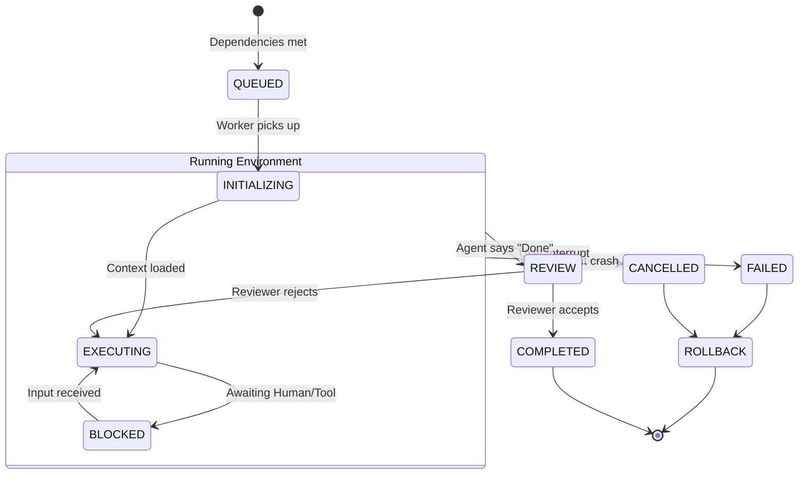

# Execution Engine

> **Version:** 1.0.0  
> **Status:** 🚧 Draft  
> **Last Updated:** 2026-07-14  
> **Owner:** Platform Team  
> **Upstream:** [System Architecture](system-architecture.md), [Orchestrator Design](orchestrator-design.md)

---

## Purpose

While the Orchestrator routes events, the Execution Engine **does the work**. It is responsible for taking a concrete Subtask, instantiating the correct Agent, providing it with a sandboxed environment, managing its lifecycle, and capturing its output.

It manages directed acyclic graphs (DAGs) of tasks, parallelism, and destructive operation rollbacks.

---

## Architecture

The Execution Engine runs as an independent pool of workers.

```mermaid
C4Component
    title Execution Engine Components
    
    SystemQueue(bus, "Event Bus", "NATS")
    
    Component_Boundary(exec, "Execution Engine Worker Node") {
        Component(worker_pool, "Worker Pool", "Thread pool managing active subtasks")
        Component(dag_runner, "DAG Runner", "Resolves dependencies before queueing")
        Component(sandbox, "Sandbox Mgr", "Isolates FS and Terminal access")
        Component(checkpoint, "Checkpoint Mgr", "Creates Git/FS snapshots")
        Component(rollback, "Rollback Mgr", "Restores snapshots on failure/cancel")
        Component(timeout, "Timeout Mgr", "Enforces SLAs on agents")
    }
    
    Container(agent_runtime, "Python AI Runtime", "Executes the actual LLM logic")
    Container(tool_engine, "Tooling Engine", "Executes shell/fs commands")
    
    Rel(bus, dag_runner, "Consumes Task DAGs")
    Rel(dag_runner, worker_pool, "Dispatches Ready Subtasks")
    Rel(worker_pool, sandbox, "Requests Environment")
    Rel(sandbox, checkpoint, "Triggers Snapshot before mutation")
    Rel(worker_pool, timeout, "Registers SLA limit")
    Rel(worker_pool, agent_runtime, "Invokes Agent via gRPC")
    Rel(agent_runtime, tool_engine, "Requests tool execution")
    Rel(worker_pool, bus, "Emits Progress/Result Events")
```

---

## Core Capabilities

### 1. DAG Execution (Dependency Graph)
When the Planner creates a plan, it emits a DAG of subtasks (e.g., `Setup DB` must happen before `Write Backend`, which can happen in parallel with `Write Frontend`). The DAG Runner monitors completion events and only pushes a subtask into the Worker Pool when all its dependencies are met.

### 2. Parallel Execution
The Worker Pool allows multiple agents to run simultaneously (hardware permitting). If the DAG allows it, the `BackendAgent` and `FrontendAgent` will run in parallel threads, requesting inference from the LLM concurrently.

### 3. Checkpointing & Rollback
Before an agent executes any mutating tool (file write, terminal command), the Checkpoint Manager takes a snapshot.
- **File Changes:** Tracked via a hidden Git branch or shadow file copies.
- **Rollback:** If the user clicks "Cancel" or if the agent enters an unrecoverable crash loop, the Rollback Manager restores the workspace to the exact state before the task began.

### 4. Sandboxing & Process Isolation
Agents do not get raw terminal access. They execute within a Sandbox Manager that:
- Chroots or restricts file paths to the workspace boundary.
- Intercepts network calls (if restricted mode is on).
- Wraps shell commands in timeout wrappers.

### 5. Timeout & Deadlock Handling
Every agent has a defined SLA in its contract (e.g., Code Generation = max 5 minutes). The Timeout Manager tracks this. If an agent hangs (e.g., LLM inference stalls or a shell command like `npm install` prompts for input and hangs), the Timeout Manager kills the process, triggers a rollback, and emits a `TaskFailedEvent(Timeout)`.

---

## The Execution State Machine

Every subtask follows a strict state machine enforced by the Worker Pool.



---

## Design Rationale & Trade-offs

**Why use a DAG instead of sequential execution?**
Sequential execution is easier to program, but vastly slower. By explicitly defining dependencies between tasks, we can utilize multi-core CPUs and parallel GPU inference (if available) to cut multi-file generation times by 50% or more.

**Why does the Execution Engine handle checkpoints, not the Tools?**
If a single tool handled its own undo, we couldn't roll back an entire 15-step task atomically. Checkpointing must happen at the execution boundary to guarantee the workspace returns to a clean state.

**Why Process Isolation?**
The Python AI runtime can crash (e.g., OOM exception during inference). If it ran in the same process as the Execution Engine, it would kill the engine. By treating the AI runtime as an external gRPC service invoked by the Worker Pool, we ensure the Engine survives to report the failure and initiate rollback.

---

## Traceability

- Implements [FR-305 (Parallel Agent Execution)](../02-prd/prd.md) and [FR-205 (Pause/Cancel/Resume)](../02-prd/prd.md).
- Fulfills [EP-05 (Fail Safe)](../08-governance/engineering-principles.md) via checkpoints and rollbacks.
