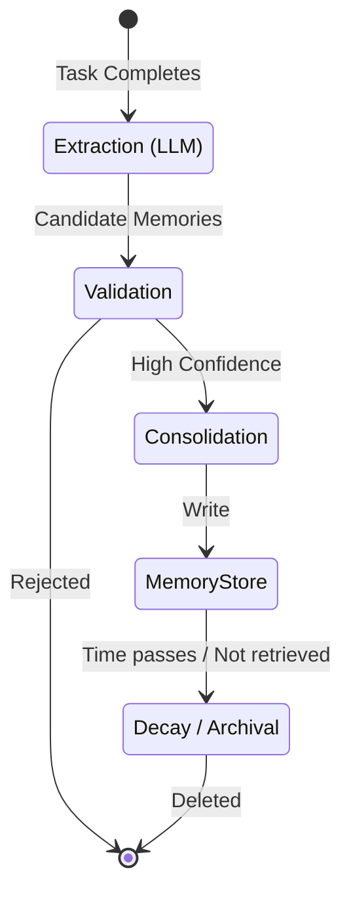

# Layered Memory System

> **Version:** 1.0.0  
> **Status:** 🚧 Draft  
> **Last Updated:** 2026-07-14  
> **Owner:** AI Team  
> **Upstream:** [System Architecture](system-architecture.md), [Workspace Model](workspace-model.md)  
> **ADR References:** [ADR-012](../appendix/adr/012-why-qdrant.md), [ADR-005](../appendix/adr/005-why-bge-m3.md)

---

## Purpose

Stateless AI systems force users to repeat context continuously. Atlas implements a Layered Memory System to ensure that context learned in one task or session is permanently available, scoped correctly, and retrieved intelligently for all future tasks.

---

## The 10 Layers of Memory

Memory in Atlas is hierarchical. Layers at the top are short-lived but highly specific. Layers at the bottom are permanent but broad.

### 1. Session Memory
- **Purpose:** Ephemeral conversation history. "What did we just discuss?"
- **Retention:** Deleted or archived when the session ends.
- **Retrieval:** Direct context injection (sliding window).

### 2. Working Memory (Scratchpad)
- **Purpose:** Temporary storage for an agent actively executing a task. E.g., holding a JSON payload it intends to parse in the next step.
- **Retention:** Cleared when the subtask completes.
- **Retrieval:** Exact match (key-value).

### 3. Task Memory
- **Purpose:** Facts learned while solving a specific task. E.g., "The API requires an `Authorization: Bearer` header."
- **Retention:** Promoted to Project Memory if relevant, otherwise decays over 30 days.
- **Retrieval:** Semantic search + Task ID filtering.

### 4. Agent Memory
- **Purpose:** An individual agent's private notes on how to do its job better. E.g., the Coding Agent noting that a specific linter rule always fails on this project.
- **Retention:** Permanent, scoped to the specific agent profile.
- **Retrieval:** Injected into the agent's system prompt.

### 5. Repository Memory
- **Purpose:** The semantic and structural graph of the codebase (See [Repository Intelligence](../04-subsystems/repository-intelligence.md)).
- **Retention:** Tied to the Git tree. Updated incrementally.
- **Retrieval:** RAG + Graph traversal.

### 6. Architecture Memory
- **Purpose:** Explicit architectural rules. "All database calls must use the Repository pattern."
- **Retention:** Permanent. Only updated by the Architect agent or the User.
- **Retrieval:** Injected into Planner and Code Review agents for every task.

### 7. Decision Memory (ADRs)
- **Purpose:** "Why did we do it this way?" Historical context on architectural choices.
- **Retention:** Permanent, immutable (append-only/supersede).
- **Retrieval:** RAG when an agent questions an existing pattern.

### 8. Knowledge Memory (Documentation)
- **Purpose:** External knowledge brought into the project. E.g., "Here is the Stripe API documentation we are integrating."
- **Retention:** Persistent, managed by the user.
- **Retrieval:** RAG triggered by specific tools.

### 9. User Preference Memory
- **Purpose:** "Don't use Tailwind," "Use 4 spaces," "Always write Python with type hints."
- **Retention:** Permanent across all projects.
- **Retrieval:** Global system prompt injection.

### 10. Long-Term Core
- **Purpose:** The generalized learnings of the system across months of use, abstracted from specific codebases.
- **Retention:** Permanent.
- **Retrieval:** Asynchronous background training or dynamic few-shot prompt construction.

---

## Memory Promotion and Decay

Not all information is worth keeping. Atlas uses an active lifecycle manager.

### Policies
1. **Extraction:** At the end of every task, a background process runs DeepSeek R1 to extract "generalized facts" from the execution log.
2. **Relevance Scoring:** Every memory has a score. Reading a memory increases its score.
3. **Decay:** Task memories decay by 1% every day they are not accessed.
4. **Pruning:** Memories that fall below a threshold score are summarized and archived.

---

## Storage Architecture

Memory is a hybrid of structured metadata and unstructured vectors.

- **SQLite/PostgreSQL:** Stores the Metadata (Layer ID, Timestamp, TTL, Access Count, Source Task ID).
- **Qdrant:** Stores the Embeddings (generated by BGE-M3) and the actual text content.

*Data Flow:*
1. Agent requests memory via tool: `search_memory(query: "auth headers")`
2. Orchestrator calls Memory Service.
3. Memory Service converts query to vector.
4. Memory Service queries Qdrant with filters (e.g., `layer IN (Architecture, Task) AND project_id = X`).
5. Results are returned to Agent.

---

## Risks and Trade-offs

| Risk | Mitigation |
|---|---|
| **Conflicting Memories** | Newer memories supersede older ones. High-priority layers (Architecture) override low-priority layers (Task). |
| **Context Window Bloat** | Only top-K relevant memories are injected. Hard token limits are enforced. |
| **Privacy Leakage** | Memories are strictly partitioned by `project_id`. Global memory never contains source code. |

---

## Traceability

- Implements [FR-500 (Memory & Learning)](../02-prd/prd.md).
- Fulfills [EP-06 (Memory is Architecture)](../08-governance/engineering-principles.md).
