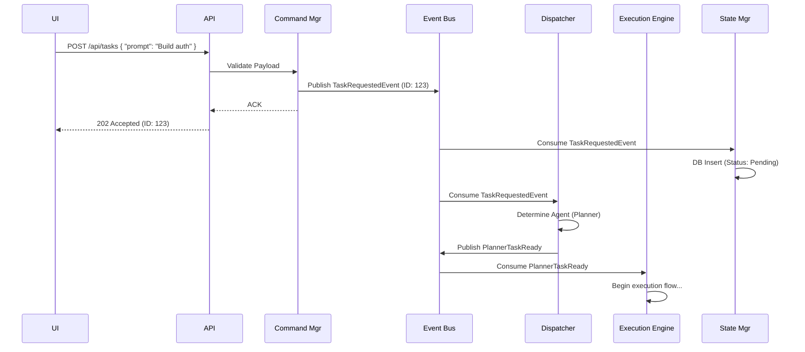

# Orchestrator Design

> **Version:** 1.0.0  
> **Status:** 🚧 Draft  
> **Last Updated:** 2026-07-14  
> **Owner:** Platform Team  
> **Upstream:** [System Architecture](system-architecture.md)  
> **ADR References:** [ADR-007](../appendix/adr/007-why-rust-core.md), [ADR-010](../appendix/adr/010-why-event-driven.md), [ADR-011](../appendix/adr/011-why-nats.md)

---

## Purpose

The Orchestrator is the kernel of the Atlas AI Operating System. It does not execute tasks or run AI models. Its sole purpose is to route events, manage system resources, enforce state machine transitions, and maintain the health of the system. 

It is designed as an **Event-Driven Router**, decoupling the UI, the agents, and the execution engine.

---

## Component Architecture

The Orchestrator is divided into 8 internal managers that subscribe to the Event Bus.

```mermaid
C4Component
    title Component diagram for Atlas Orchestrator
    
    Component_Boundary(orch, "Orchestrator") {
        Component(cmd_mgr, "Command Manager", "Validates incoming UI commands and converts to Events")
        Component(route_mgr, "Dispatcher", "Routes events to appropriate sub-queues")
        Component(state_mgr, "State Manager", "Maintains global system state (CQRS write side)")
        Component(res_mgr, "Resource Manager", "Tracks RAM/VRAM, loads/unloads models")
        Component(app_mgr, "Approval Manager", "Pauses flows requiring human intervention")
        Component(retry_mgr, "Retry Manager", "Implements exponential backoff for failed events")
        Component(dead_letter, "Dead Letter Manager", "Captures unprocessable events")
        Component(health, "Health Monitor", "Pings agents, detects deadlocks")
    }
    
    SystemQueue(bus, "Event Bus", "NATS")
    
    Rel(bus, cmd_mgr, "Listens for Commands")
    Rel(route_mgr, bus, "Publishes Routed Events")
    Rel(bus, state_mgr, "Consumes State Events")
    Rel(health, bus, "Publishes Agent Timeout Events")
    Rel(app_mgr, bus, "Publishes Approval Requested/Granted")
```

---

## Core Components Defined

### 1. Event Bus (NATS)
The backbone of the system. It guarantees at-least-once delivery using JetStream. It is partitioned by subjects (e.g., `atlas.task.*`, `atlas.agent.*`, `atlas.system.*`).

### 2. Command Manager (Queue)
Receives synchronous commands from the UI (e.g., "Stop Execution", "Run Task"). It validates the payload schema, generates a Correlation ID, and publishes an async Event to the Bus. It returns HTTP 202 (Accepted) to the UI immediately.

### 3. Dispatcher
Listens to generalized events (e.g., `SubtaskCreated`) and routes them to specific Agent queues (e.g., `queue.agent.coder` or `queue.agent.planner`) based on the task type and required capabilities.

### 4. Resource Manager
Monitors system RAM and GPU VRAM. It instructs the Inference layer (Ollama) to swap models (e.g., unload Qwen, load DeepSeek) based on which agent has pending tasks in the queue.

### 5. State Manager
The only component allowed to update the central SQL database regarding global execution state. It listens to `Started`, `Progress`, and `Completed` events to update the `Tasks` and `Sessions` tables.

### 6. Approval Manager
Acts as a circuit breaker. When an agent emits a `ToolInvocationRequested` event for a destructive tool (e.g., `rm -rf`), the Approval Manager intercepts it, blocks the agent's queue, and emits an `ApprovalRequired` event to the UI. Once the UI replies with `ApprovalGranted`, it unblocks the queue.

### 7. Retry & Dead-Letter Managers
If a subscriber crashes while processing an event, the Retry Manager republishes it with exponential backoff. If it fails 3 times, it goes to the Dead-Letter Queue (DLQ) for human inspection.

---

## Flow: Submitting a Task

This sequence diagram shows how the Orchestrator decoupling works in practice.



---

## Design Rationale

**Why decouple Orchestration from Execution?**
If the Orchestrator actually *ran* the AI models or executed the shell commands, a crashing AI model or a runaway infinite loop in a script would bring down the entire Atlas OS. By isolating Orchestration as a pure event router, it remains highly responsive (microseconds) even when the system is under massive AI workload stress.

**Why a Resource Manager?**
In a local-first system with 3 large models (Qwen, DeepSeek, BGE-M3) but limited VRAM (e.g., 16GB), they cannot all be loaded simultaneously. The Resource Manager acts like an OS memory pager, swapping models in and out of VRAM based on queue depth.

---

## Future Evolution

- **Distributed Agents:** Because everything passes through the Event Bus, adding a remote agent running on a massive GPU server in the basement simply requires that agent to connect to the NATS server and subscribe to the `queue.agent.coder` subject. The Orchestrator doesn't need to change a single line of code.

---

## Traceability

- Implements [AP-03 (Event-Driven Communication)](../08-governance/architecture-principles.md).
- Fulfills [EP-05 (Fail Safe)](../08-governance/engineering-principles.md) by isolating orchestration from execution.
