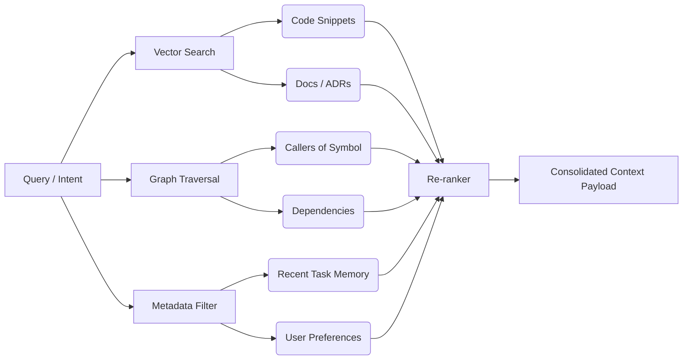

# RAG++ Architecture

> **Version:** 1.0.0  
> **Status:** 🚧 Draft  
> **Last Updated:** 2026-07-14  
> **Owner:** AI Team  
> **Upstream:** [Context Engine](context-engine.md), [Layered Memory System](memory-system.md)

---

## Objective
Standard RAG (Retrieval-Augmented Generation) retrieves chunks of text based on vector similarity. This is insufficient for software engineering. RAG++ is a multi-source retrieval pipeline that combines semantic search, deterministic graph traversal, and metadata filtering to build high-precision context payloads.

---

## Cognitive Contract

| Section | Specification |
|---|---|
| **Objective** | Retrieve highly relevant, multi-modal context for agents. |
| **Inputs** | Semantic Query, Current Task ID, Active File Path. |
| **Outputs** | Ranked, consolidated list of context blocks. |
| **Dependencies** | Qdrant, BGE-M3, SQLite Knowledge Graph. |
| **Failure Modes** | Retrieval of irrelevant, distractor information. |
| **Recovery** | Context Engine strips low-ranked results dynamically. |
| **KPIs** | Context Precision (%), Context Recall (%). |
| **Extension Points** | Custom retrieval plugins (e.g., retrieving from Jira/GitHub). |

---

## Multi-Source Retrieval Pipeline

When an agent requests context, the RAG++ pipeline fires multiple asynchronous queries across different domains:

### 1. The Vector Pass
Queries Qdrant using BGE-M3 embeddings.
- Targets: Documentation, PRDs, previous Task Memories, and raw code chunks.

### 2. The Graph Pass
Queries the SQLite Knowledge Graph deterministically.
- Targets: If the agent is looking at `UserController`, the Graph Pass automatically fetches the `IUserService` interface it implements, and the top 3 functions that call it.

### 3. The Metadata Pass
Queries relational data based on the active Session/Task.
- Targets: Global User Preferences, Project Architecture constraints.

---

## Re-ranking and Consolidation

Fetching from multiple sources yields too much data for the context window. RAG++ uses a lightweight cross-encoder (or heuristic scoring) to re-rank the combined results.

**Scoring Weights:**
1. Hard constraints (Architecture Memory, User Preferences) = `Weight: 1.0` (Mandatory).
2. Direct Graph edges (Functions called by active file) = `Weight: 0.8`.
3. Vector similarity matches = `Weight: 0.4 - 0.7`.

The final payload is formatted as XML and handed to the [Context Engine](context-engine.md) for token budgeting.

---

## Traceability
- Implements the retrieval mechanism for the [Layered Memory System](memory-system.md).
- Utilizes the [Knowledge Graph](knowledge-graph-architecture.md) for deterministic fetching.
