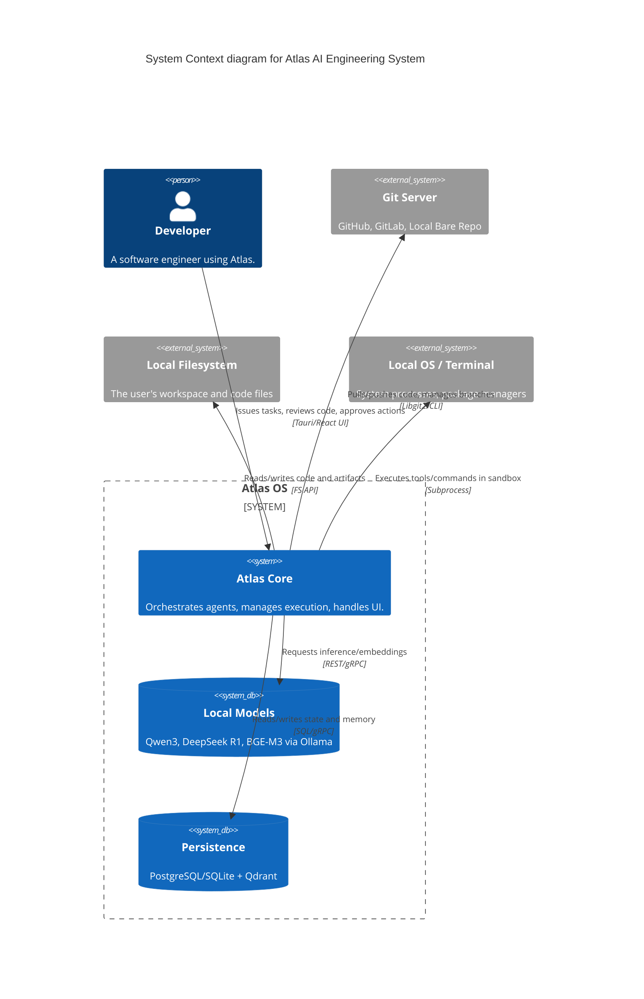
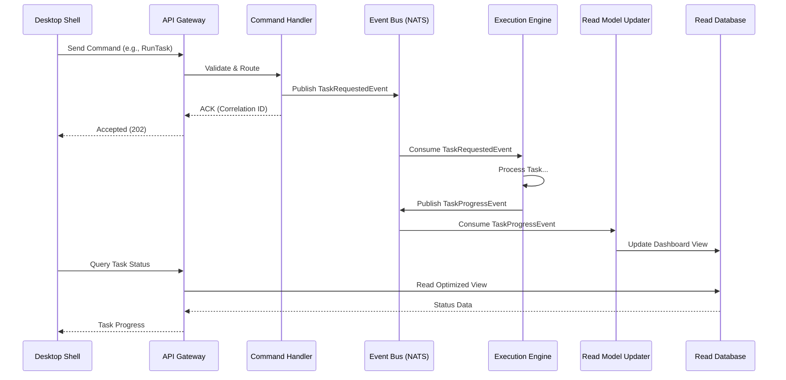

# System Architecture

> **Version:** 1.0.0  
> **Status:** 🚧 Draft  
> **Last Updated:** 2026-07-14  
> **Owner:** Architecture Team  
> **Upstream:** [Vision](../01-vision/vision.md), [PRD](../02-prd/prd.md)  
> **ADR References:** [ADR-001](../appendix/adr/001-multi-agent-architecture.md), [ADR-006](../appendix/adr/006-local-first-design.md), [ADR-010](../appendix/adr/010-why-event-driven.md)

---

## Purpose

This document defines the macro-level architecture of the Atlas AI Engineering System. Atlas is designed not merely as a coding assistant, but as an **AI Operating System for Software Engineering**. 

The architecture must optimize for extensibility, reliability, observability, and autonomous collaboration between specialized agents. It must be resilient enough to run locally today, while structurally sound enough to scale to distributed, multi-machine enterprise clusters tomorrow.

---

## High-Level System Context

The System Context diagram illustrates the boundaries of Atlas and its interactions with external actors.



---

## Container Architecture

Atlas follows a Strict Clean Architecture ([AP-01](../08-governance/architecture-principles.md)) with hexagonal ports and adapters ([AP-02](../08-governance/architecture-principles.md)).

```mermaid
C4Container
    title Container diagram for Atlas
    
    Container_Boundary(frontend, "Frontend Layer") {
        Container(ui, "Desktop Shell", "Tauri, React, TS", "Provides UI, visualizes progress, renders diffs")
    }
    
    Container_Boundary(core, "Core OS (Rust)") {
        Container(api, "API Gateway", "Rust/Axum", "Handles UI requests, routes commands")
        Container(orch, "Orchestrator", "Rust", "Event-driven routing, scheduling, state management")
        Container(exec, "Execution Engine", "Rust", "Task queuing, parallel execution, rollback")
        Container(eventbus, "Event Bus", "NATS (Embedded)", "Async pub/sub messaging backbone")
        Container(tools, "Tooling Engine", "Rust", "Sandboxed execution, filesystem access")
    }
    
    Container_Boundary(ai, "Intelligence Layer (Python/Rust)") {
        Container(runtime, "AI Runtime", "Python", "Manages prompts, model routing, agent execution")
        Container(rag, "RAG Pipeline", "Rust/Python", "Indexing, chunking, re-ranking")
        Container(repo_intel, "Repo Intelligence", "Rust/Tree-sitter", "AST parsing, graph building")
    }
    
    Container_Boundary(data, "Data Layer") {
        ContainerDb(rel_db, "Relational DB", "PostgreSQL/SQLite", "Metadata, state, queues, audit")
        ContainerDb(vec_db, "Vector DB", "Qdrant", "Embeddings, semantic search")
    }
    
    Rel(ui, api, "Commands / Queries", "IPC/WebSocket")
    Rel(api, orch, "Routes Commands", "In-Process")
    Rel(orch, eventbus, "Publishes/Subscribes", "NATS Protocol")
    Rel(exec, eventbus, "Consumes Tasks", "NATS Protocol")
    Rel(exec, runtime, "Invokes Agents", "gRPC")
    Rel(runtime, models, "Inference", "REST")
    Rel(runtime, tools, "Tool Invocation", "gRPC")
    Rel(runtime, rag, "Semantic Search", "In-Process/gRPC")
    Rel(orch, rel_db, "Persist State", "SQLx")
    Rel(rag, vec_db, "Persist Vectors", "gRPC")
    Rel(repo_intel, eventbus, "File Change Events", "NATS Protocol")
```

---

## Core Subsystems

### 1. Orchestration Subsystem
**Status:** Event-Driven, Fully Async  
The orchestrator does not execute tasks. It acts as the kernel of the Atlas OS, routing events, managing queues, and maintaining global state. It decouples the UI from the execution logic entirely via the NATS Event Bus.
*See [Orchestrator Design](orchestrator-design.md)*

### 2. Execution Subsystem
**Status:** Independent, Deterministic  
The Execution Engine is responsible for running the Directed Acyclic Graphs (DAGs) of tasks generated by the Planner. It handles parallelism, dependencies, timeouts, checkpointing, and rollback. It operates independently of the Orchestrator.
*See [Execution Engine](execution-engine.md)*

### 3. Agent Subsystem
**Status:** Decentralized, Specialized  
Agents are isolated state machines. They do not share memory. They communicate strictly via the Event Bus. Each agent has a formal contract defining its inputs, outputs, SLAs, and allowed tools.
*See [Agent Architecture](agent-architecture.md) and [Agent Lifecycle](agent-lifecycle.md)*

### 4. Memory Subsystem
**Status:** Layered, Persistent  
Atlas treats memory as a 10-layer hierarchical subsystem (from ephemeral Session memory down to permanent Architecture memory). It combines relational metadata with vector semantics.
*See [Memory System](memory-system.md)*

### 5. Repository Intelligence Subsystem
**Status:** Deep Semantic Graph  
Beyond simple text indexing, this subsystem parses code into ASTs using Tree-sitter and builds 7 distinct graphs (Symbol, Dependency, Import, Call, Type, Reference, Semantic) to give agents true comprehension of the codebase.
*See [Repository Intelligence](../04-subsystems/repository-intelligence.md)*

---

## Data Flow Architecture (CQRS)

Atlas implements Command-Query Responsibility Segregation (CQRS) for complex flows to separate mutations from reads, ensuring UI responsiveness during heavy background processing.



---

## Design Rationale & Trade-offs

### Rationale: AI OS over Coding Assistant
A coding assistant (like Copilot) is a simple Request/Response application. The user types, the LLM completes. 
An AI Engineer requires multi-step planning, tool usage, rollback, memory retrieval, and agent coordination. This requires Operating System-level primitives: processes (agents), IPC (event bus), filesystems (sandboxed tools), and schedulers (orchestrator).

### Trade-off: Event-Driven vs. Sequential
**Option A (Sequential):** `Planner.plan() -> Coder.code() -> QA.test()`
**Option B (Event-Driven):** `Planner` emits `PlanCreatedEvent`. `Dispatcher` routes to `Coder`. `Coder` emits `CodeGeneratedEvent`.

We chose **Option B**.
*Why:* Sequential logic is brittle. If QA fails, unwinding a sequential call stack is impossible. Event-driven architecture allows any agent to fail, the orchestrator to catch the `TaskFailedEvent`, and route it back to a `Reviewer` agent, creating a resilient, self-healing loop. It also allows plugins to intercept events without modifying core code.

### Trade-off: Embedded vs. External Dependencies
We selected embedded/in-process defaults for NATS, SQLite, and Qdrant.
*Why:* A local-first application must be trivial to install. However, by strictly adhering to Hexagonal Architecture, the ports allow these to be swapped for external clustered versions in enterprise deployments without changing a single line of domain code.

---

## Extension Points

1. **Event Bus Listeners:** Any new feature (e.g., an Analytics dashboard) can be built simply by subscribing to the NATS event bus.
2. **Agent Pool:** New specialized agents can be registered with the Orchestrator without modifying existing agents.
3. **Tool Registry:** The execution engine allows dynamic registration of new sandboxed tools via the Plugin SDK.

---

## Risks and Mitigations

| Risk | Impact | Mitigation |
|---|---|---|
| **Event Bus Bottleneck** | High latency across the system | Use NATS (handles millions of msg/sec); strict schema validation prevents malformed events crashing consumers. |
| **State Inconsistency** | UI shows wrong agent status | All state mutations happen via idempotent event handlers; Read models can be rebuilt from event history. |
| **Python/Rust Boundary Overhead** | Slower AI execution | AI workloads are I/O bound (waiting for GPU). The serialization overhead of gRPC/IPC is negligible compared to inference time. |

---

## Traceability

- Implements [EP-02 (Specialization)](../08-governance/engineering-principles.md) via independent subsystems.
- Implements [EP-07 (Extensibility)](../08-governance/engineering-principles.md) via Event-Driven Architecture.
- Complies with [AP-01 (Clean Architecture)](../08-governance/architecture-principles.md) and [AP-03 (Event-Driven Comm)](../08-governance/architecture-principles.md).
