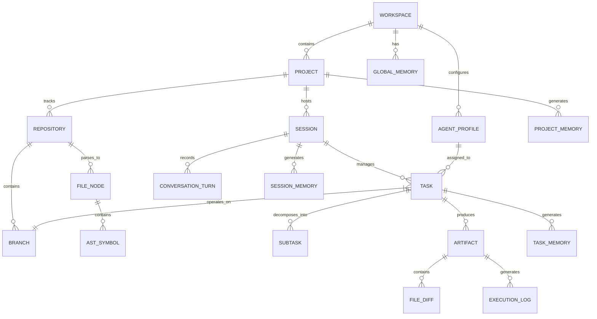
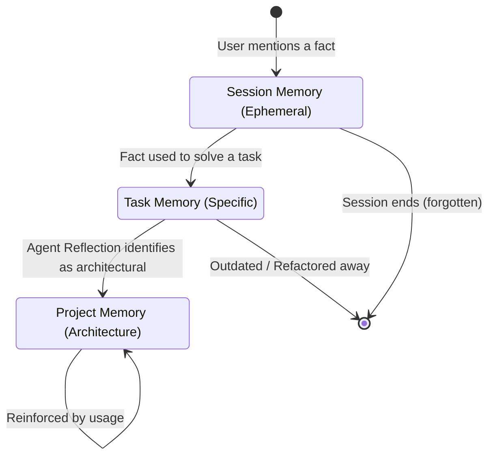

# Workspace Domain Model

> **Version:** 1.0.0  
> **Status:** 🚧 Draft  
> **Last Updated:** 2026-07-14  
> **Owner:** Architecture Team  
> **Upstream:** [System Architecture](system-architecture.md)

---

## Purpose

This document defines the complete domain model for the Atlas workspace. Many AI systems become confusing because the relationships between sessions, projects, tasks, and memory are implicit or poorly defined. 

This model explicitly defines ownership, cardinality, and relationships for every core entity in the system, serving as the blueprint for the relational database schema and the event payloads.

---

## Domain Model Graph

---

## Entity Definitions

### Level 1: Global Context

#### Workspace
The highest level of isolation. Represents the user's entire local environment on a specific machine.
- **Ownership:** Owns Projects, Global Memory, and custom Agent Profiles.
- **Relationships:** `1:N` Projects.
- **Data:** Global configurations, API keys (encrypted), UI preferences, plugin registry.
- **Lifecycle:** Created on install, destroyed on uninstall.

#### Global Memory (User Preference Memory)
- **Purpose:** Stores user-specific habits and preferences that apply across all projects (e.g., "I prefer dark mode," "Always use spaces over tabs," "My primary language is Rust").
- **Scope:** Accessible by all agents across all projects.

#### Agent Profile
- **Purpose:** Configurations, specific prompts, and enabled tools for a specific agent role.
- **Scope:** Inherited by projects, but can be overridden at the project level.

---

### Level 2: Project Context

#### Project
A logical grouping of work, typically mapping 1:1 with a product, application, or service.
- **Ownership:** Owns Repositories, Sessions, and Project Memory.
- **Relationships:** `1:N` Repositories (Monorepo support), `1:N` Sessions.
- **Data:** Project ID, Name, Environment variables, specific `.atlas.toml` config.
- **Lifecycle:** Created by user, archived/deleted by user.

#### Repository
A physical Git repository tracked by the project.
- **Ownership:** Owns Branches and the Repository Intelligence Graph (Files, ASTs, Symbols).
- **Data:** Remote URL, local path, indexing status, commit hash.

#### Project Memory
- **Purpose:** Architecture decisions, standard operating procedures, required libraries, and domain language specific to this project.
- **Scope:** Accessible across all sessions within this project.

---

### Level 3: Session Context

#### Session
A continuous period of interaction between the user and Atlas to achieve a set of related goals. Similar to a chat thread, but stateful.
- **Ownership:** Owns Tasks, Conversation Turns, and Session Memory.
- **Relationships:** `N:1` Project, `1:N` Tasks.
- **Data:** Session ID, status (active, paused, archived), timestamp.
- **Lifecycle:** Created when user initiates interaction. Automatically archived after 24h of inactivity.

#### Branch
The Git branch that the session is currently mutating.
- **Purpose:** Isolation of work. Atlas operates on feature branches to prevent breaking `main`.

#### Session Memory
- **Purpose:** Short-term context. "What were we just talking about?", "What file did I ask you to look at 5 minutes ago?"
- **Scope:** Ephemeral. Pruned heavily when the session ends; important facts are promoted to Project Memory or Task Memory.

---

### Level 4: Execution Context

#### Task
A defined goal with a clear Definition of Done. Usually generated by the Planner agent based on a Conversation Turn.
- **Ownership:** Owns Subtasks, Artifacts, and Task Memory.
- **Relationships:** `N:1` Session, `1:N` Subtasks, `1:1` Agent Assignment.
- **Data:** Task ID, Status (Pending, Running, Blocked, Review, Completed, Failed), Priority.

#### Subtask
A granular unit of work assigned to a specific agent (e.g., "Write unit tests for AuthController").
- **Data:** State machine state, assigned Agent ID, dependencies (must finish Subtask A before Subtask B).

#### Artifact
The tangible output of a Task.
- **Types:** Code Diff, Terminal Output, Memory Entry, Markdown Document.
- **Ownership:** `N:1` Task.

#### Task Memory
- **Purpose:** Context specific to completing a task. E.g., "The database is throwing a 500 error because of a missing index."
- **Scope:** Persists after the task completes, used as context for future related tasks, but lower priority than Project Memory.

---

## Memory Promotion Lifecycle

Atlas uses a promotion model for knowledge, moving from ephemeral to permanent.

1. **Session Memory:** "Use the `fetch` API for this request."
2. **Task Memory:** "The `fetch` API call to `/auth` requires a CSRF token."
3. **Project Memory (Promoted):** "All network requests in this project must use the custom `ApiClient` wrapper which handles CSRF tokens automatically."

---

## Design Rationale

1. **Why separate Session and Task?**
   Users often chat with the system (Session) to explore ideas before actually commanding the system to write code (Task). Treating chat history and execution history as separate entities prevents execution logs from polluting semantic chat history.

2. **Why separate Project and Repository?**
   Enterprise environments frequently use multiple repositories for a single project (e.g., frontend repo, backend repo, infra repo). Atlas must be able to coordinate tasks across repository boundaries within a single Project context.

3. **Why Branch at the Task/Session level?**
   Atlas must never mutate `main` directly. Tying execution to a specific Git branch allows the Execution Engine to implement the Rollback pattern natively (just `git reset --hard` or switch branches) if an agent causes catastrophic failure.

---

## Extension Points

- **Custom Artifacts:** Plugins can define new Artifact types (e.g., a "Deployment Log" artifact) by hooking into the Artifact entity.
- **Custom Memory Layers:** The layered memory architecture allows injecting new specialized memory stores (e.g., "Company Policy Memory" fetched from an external API).

---

## Traceability

- Implements [AP-05 (Repository Per Aggregate)](../08-governance/architecture-principles.md) — The schema naturally groups into Workspace, Project, Session, and Task aggregates.
- Supports [EP-06 (Memory is Architecture)](../08-governance/engineering-principles.md) by formally defining memory relationships in the domain model.
