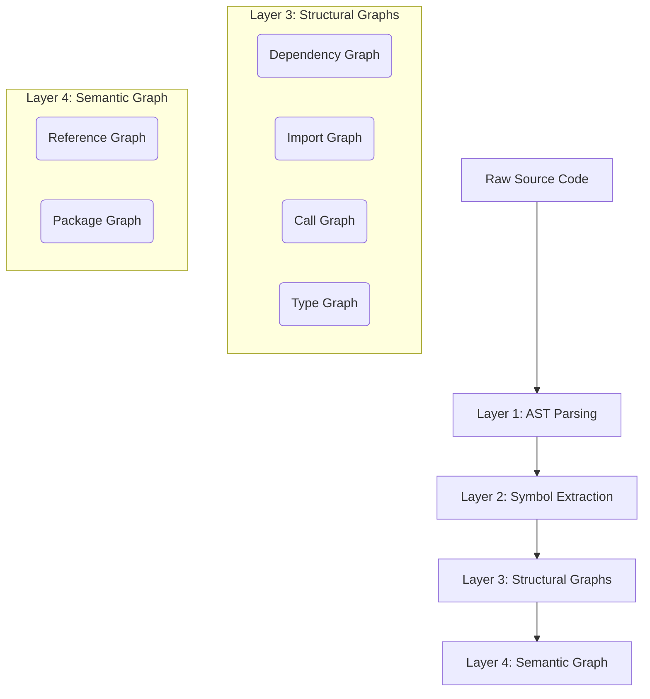
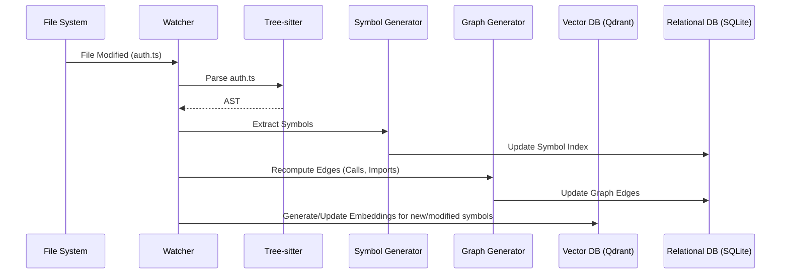

# Repository Intelligence

> **Version:** 1.0.0  
> **Status:** 🚧 Draft  
> **Last Updated:** 2026-07-14  
> **Owner:** AI Team  
> **Upstream:** [System Architecture](../03-architecture/system-architecture.md)  
> **ADR References:** [ADR-014](../appendix/adr/014-why-tree-sitter.md)

---

## Purpose

Simple vector search (RAG) is insufficient for autonomous software engineering. If an agent changes a function signature, it needs to know *exactly* what other files call that function, not just what files have text that looks semantically similar.

The Repository Intelligence subsystem transforms raw source code into a queryable knowledge graph. It provides agents with compiler-level understanding of the workspace.

---

## Intelligence Layers

Atlas builds repository intelligence in overlapping layers.

---

## Graph Definitions

### 1. Abstract Syntax Tree (AST) Parsing
- **Engine:** Tree-sitter ([ADR-014](../appendix/adr/014-why-tree-sitter.md))
- **Purpose:** The foundational layer. Converts strings of code into trees of language constructs (functions, classes, arguments, blocks).
- **Use Case:** "Give me the body of the `authenticateUser` function, ignoring the rest of the file."

### 2. Symbol Graph
- **Purpose:** Indexes every declared symbol (class, interface, function, constant, struct, enum) mapped to its file location and scope.
- **Data Model:** `Symbol { Name, Type, File, StartLine, EndLine, ParentSymbol }`
- **Use Case:** "Where is `UserRecord` defined?"

### 3. Import Graph
- **Purpose:** Maps exactly which files import which other files.
- **Data Model:** Directed acyclic graph of file paths.
- **Use Case:** "If I modify `utils/format.ts`, which files need to be tested?"

### 4. Dependency Graph
- **Purpose:** Maps external dependencies (from `package.json`, `Cargo.toml`, `requirements.txt`).
- **Data Model:** `Package -> Version -> Scope (dev/prod)`
- **Use Case:** "Do we already have a library installed that handles JWTs?"

### 5. Call Graph
- **Purpose:** Maps which functions invoke which other functions.
- **Data Model:** Directed graph of Symbol IDs.
- **Use Case:** "If I change the return type of `fetchUserData`, what functions will break?"

### 6. Type Graph
- **Purpose:** Maps inheritance, interface implementation, and type composition.
- **Use Case:** "Find all classes that implement `IAuthenticationProvider`."

### 7. Reference Graph
- **Purpose:** Maps all usages of a specific symbol across the entire codebase.
- **Use Case:** "Find everywhere `GlobalConfig.maxRetries` is read or written."

### 8. Package Graph
- **Purpose:** Maps internal modules/packages and their visibility boundaries.
- **Use Case:** "Is this helper function part of the public API of the `auth` module?"

### 9. Semantic Graph (Vector + Structure)
- **Purpose:** Fuses the structural graphs with vector embeddings (using BGE-M3).
- **Use Case:** "Find functions related to 'password hashing' that are called by the `UserController`."

---

## The Intelligence Pipeline

When a file changes, the intelligence pipeline updates incrementally.

---

## Agent Usage

Agents access Repository Intelligence through specific tools.

| Tool | Agent | Use Case |
|---|---|---|
| `find_symbol_definition` | All | Quickly jump to code without grep |
| `get_callers_of` | Architect, QA | Identify blast radius of a proposed change |
| `get_dependencies` | Planner | Determine build order for a multi-file feature |
| `semantic_code_search` | Backend, Frontend | "How do we normally handle database connections here?" |

---

## Design Rationale

**Why not just use an LSP (Language Server Protocol)?**
LSPs are designed for IDEs. They are heavy, language-specific, and prone to crashing. Atlas needs a unified, cross-language intelligence layer that can be queried programmatically via SQL or GraphQL-like APIs, without managing 15 different language server processes.

**Why not rely purely on LLM Context?**
LLMs hallucinate. If you ask an LLM "what files call this function" based purely on a RAG retrieval, it will guess. The Call Graph provides deterministic, 100% accurate compiler-level truth.

---

## Failure Scenarios & Mitigations

| Scenario | Impact | Mitigation |
|---|---|---|
| **Syntax Error in File** | Tree-sitter fails to parse | Tree-sitter is fault-tolerant. It builds the AST for the valid parts of the file and marks the error node, allowing partial graph updates. |
| **Massive Refactor (1000+ files)** | Indexing blocks execution | Pipeline prioritizes indexing the active task's workspace first, deferring background files. |
| **Dynamic Language Ambiguity** | Python/JS call graphs are probabilistic | For dynamic languages, the Call Graph acts as a "highly likely" index, supplemented by Semantic Search. |

---

## Traceability

- Implements [FR-600 (Repository Intelligence)](../02-prd/prd.md) requirements.
- Uses Tree-sitter as mandated by [ADR-014](../appendix/adr/014-why-tree-sitter.md).
- Provides deterministic truth to prevent AI hallucination, supporting [EP-04 (Quality Over Speed)](../08-governance/engineering-principles.md).
