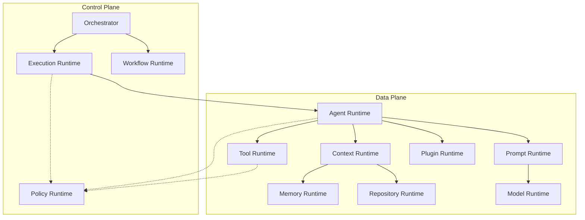

# Runtime Subsystem Overview

> **Version:** 1.0.0-draft  
> **Status:** 🚧 Draft  
> **Created:** 2026-07-14  

---

## Overview

The Runtime Subsystem is the execution heart of Atlas. It is not a monolithic engine, but a distributed set of specialized runtimes separated into a **Control Plane** (which decides and schedules) and a **Data Plane** (which executes). 

This clear separation ensures that scaling, security boundaries, and architectural isolation are maintained as Atlas evolves.

---

## Architecture Topology

---

## The Runtimes

### Control Plane Runtimes
The Control Plane owns scheduling, policy, and state management.
- **[Execution Runtime](02-execution-runtime.md):** Owns task lifecycles, queues, and resources. Stateful.
- **[Policy Runtime](10-policy-runtime.md):** Owns security rules, rate limits, and capability validation. Stateless.
- **[Workflow Runtime](11-workflow-runtime.md):** Owns DAG orchestration, checkpointing, and human approvals. Stateful.

### Data Plane Runtimes
The Data Plane owns the actual work and execution of tasks.
- **[Agent Runtime](01-agent-runtime.md):** Owns agent execution pipelines. Stateless.
- **[Context Runtime](03-context-runtime.md):** Owns context assembly. Stateless.
- **[Memory Runtime](04-memory-runtime.md):** Owns memory caching and persistence (Working, Session, Repo, etc.). Stateful.
- **[Tool Runtime](05-tool-runtime.md):** Owns tool execution and sandboxing. Stateless.
- **[Prompt Runtime](06-prompt-runtime.md):** Owns prompt generation. Stateless.
- **[Plugin Runtime](07-plugin-runtime.md):** Owns plugin sandbox and execution. Stateless.
- **[Model Runtime](08-model-runtime.md):** Owns LLM execution (Ollama, vLLM, etc.). Stateless.
- **[Repository Runtime](09-repository-runtime.md):** Owns the repository graph (AST, dependencies). Stateful.

---

## Runtime Interaction Matrix

This matrix prevents hidden dependencies from emerging by strictly mapping relationships and state.

| Runtime | Owns | Type | Calls | Called By | Depends On | Emits | Consumes |
|---|---|---|---|---|---|---|---|
| **Agent Runtime** | Agent execution | Stateless | Prompt Runtime, Tool Runtime, Memory Runtime | Execution Runtime | Context Runtime, Policy Runtime | `AgentStarted`, `AgentCompleted` | `ExecuteTask`, `ContextResolved` |
| **Execution Runtime** | Task lifecycle | Stateful | Agent Runtime | Orchestrator | Queue, Scheduler | `TaskStarted`, `TaskCompleted` | `ScheduleTask` |
| **Context Runtime** | Context assembly | Stateless | Memory Runtime, Repository Runtime | Agent Runtime | Workspace | `ContextResolved` | `ContextRequest` |
| **Memory Runtime** | Memory cache | Stateful | Storage (SQLite, Qdrant) | Context Runtime, Agent Runtime | Storage | `MemoryStored` | `MemoryWrite` |
| **Tool Runtime** | Tool execution | Stateless | Subprocess, Sandbox | Agent Runtime | Tool Registry, Policy Runtime | `ToolExecuted` | `ExecuteTool` |
| **Prompt Runtime** | Prompt generation | Stateless | Model Runtime | Agent Runtime | Prompt Registry | `PromptAssembled` | `GeneratePrompt` |
| **Plugin Runtime** | Plugin execution | Stateless | Plugin Sandbox | Agent Runtime | Plugin Registry, Policy Runtime | `PluginExecuted` | `InvokePlugin` |
| **Model Runtime** | LLM execution | Stateless | Local LLMs (Ollama) | Prompt Runtime | Compute Resources | `ModelResponded` | `ExecuteModel` |
| **Repository Runtime** | Repository graph | Stateful | Tree-sitter | Context Runtime | Filesystem | `GraphUpdated` | `IndexRepository` |
| **Policy Runtime** | Security & Rules | Stateless | None | All Runtimes | Configuration | `PolicyViolation` | `ValidatePolicy` |
| **Workflow Runtime** | DAG orchestration | Stateful | Execution Runtime | Orchestrator | State Manager | `WorkflowStarted` | `CreateWorkflow` |

---

## Runtime Conformance Checklist

Every individual runtime specification in this subsystem must pass the following checklist to be considered complete:

- [ ] Public interface defined
- [ ] Inputs documented
- [ ] Outputs documented
- [ ] Events documented
- [ ] Errors documented
- [ ] Metrics documented
- [ ] Policies referenced
- [ ] Security reviewed
- [ ] Tests defined
- [ ] Benchmarks defined
- [ ] Machine-readable contracts linked (Schemas)
- [ ] ADR traceability complete
