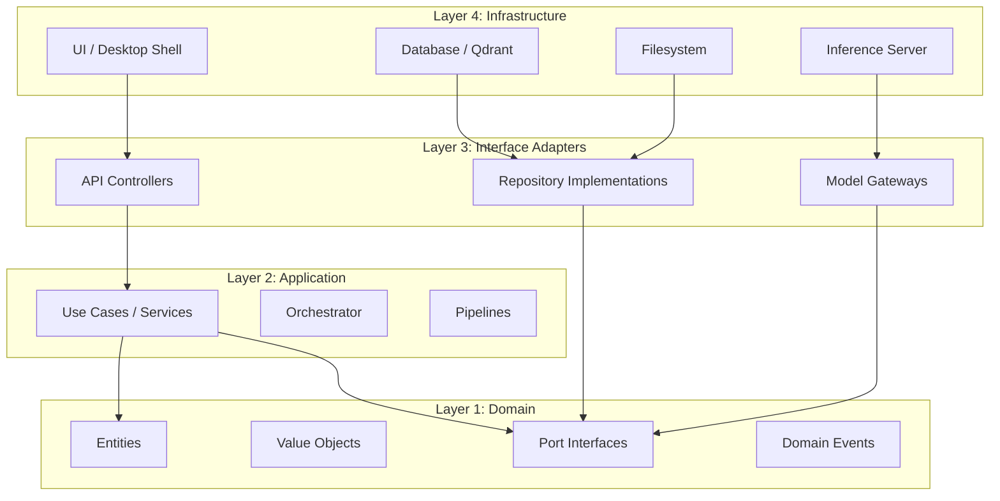
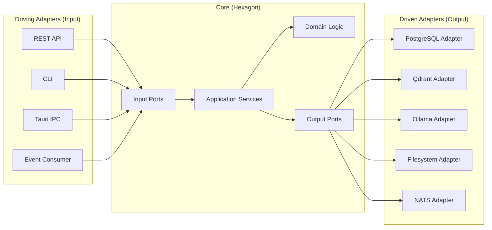
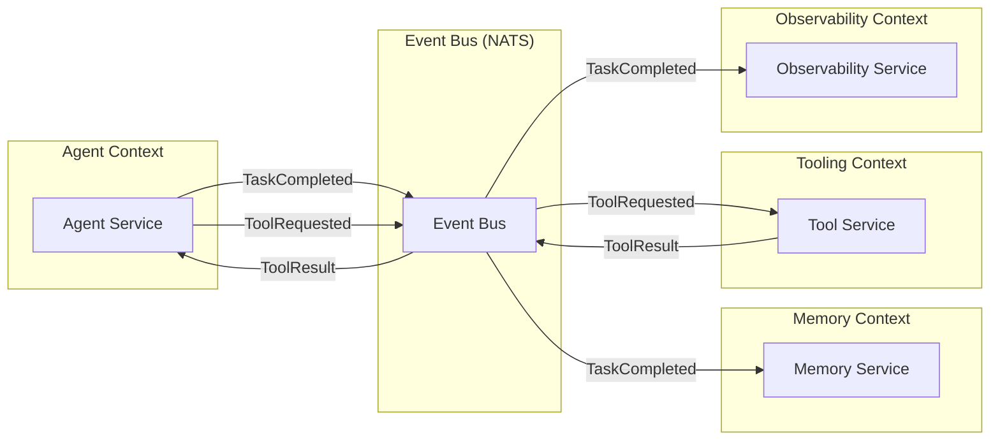
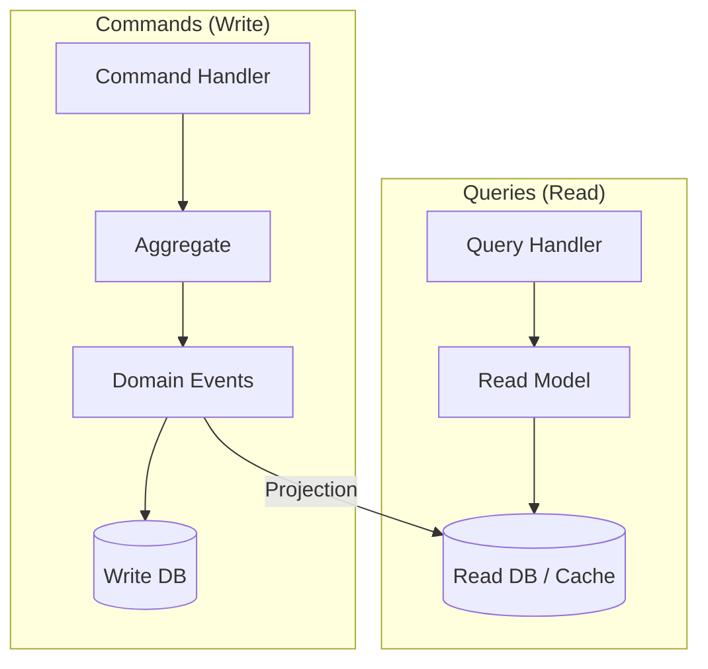
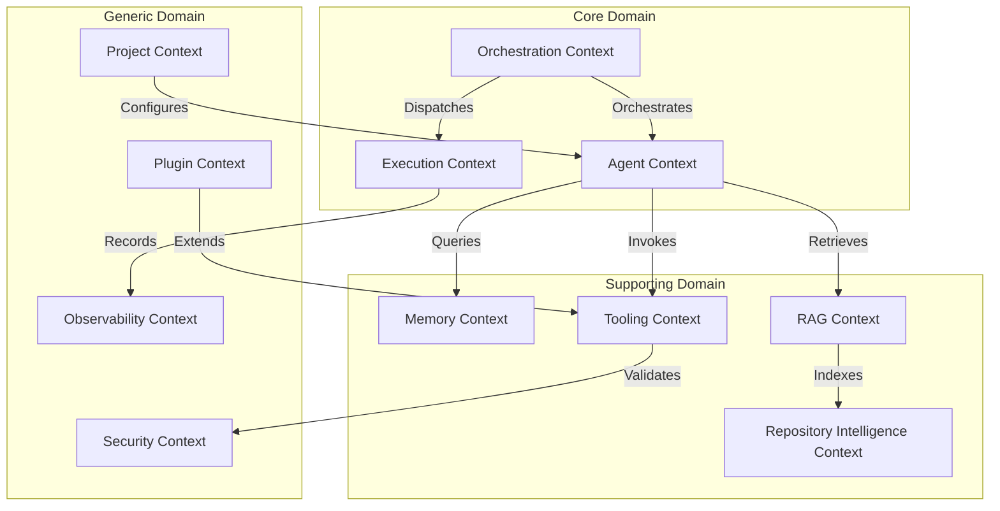

# Architecture Principles

> **Version:** 1.0.0  
> **Status:** ✅ Complete  
> **Last Updated:** 2026-07-14  
> **Owner:** Architecture Team  
> **Upstream:** [Engineering Principles](engineering-principles.md)

---

## Purpose

Architecture principles define the **structural constraints and invariants** that every component, service, and module must respect. While [Engineering Principles](engineering-principles.md) define *how we think*, Architecture Principles define *how we build*.

These are not suggestions. They are load-bearing walls. Violating them requires an ADR with explicit justification.

---

## AP-01: Clean Architecture — Dependencies Point Inward

**Statement:** Dependencies always point from outer layers (infrastructure, UI) toward inner layers (domain, core). Inner layers never depend on outer layers.



**Why:** Clean architecture ensures that the domain logic — the core value of Atlas — is never contaminated by infrastructure concerns. We can swap databases, inference servers, or UI frameworks without touching the domain.

**Implications:**
- Domain entities never import infrastructure packages
- Use cases depend on port interfaces, not concrete implementations
- Infrastructure implements port interfaces defined in the domain
- Dependency injection wires concrete implementations at startup

---

## AP-02: Hexagonal Architecture — Ports and Adapters

**Statement:** Every external dependency is accessed through a **port** (interface) with a concrete **adapter** implementation. No domain logic directly calls external systems.



**Why:** This makes every external dependency swappable. Today we use Ollama; tomorrow we might use vLLM. Today we use Qdrant; tomorrow we might use Milvus. The core never knows or cares.

**Implications:**
- Every external system has a port interface in the domain
- Every port has at least one adapter implementation
- Adapters are the only place that import external libraries
- Testing uses mock/fake adapters, not the real external systems

---

## AP-03: Event-Driven Communication Between Bounded Contexts

**Statement:** Bounded contexts (agent system, memory system, tooling system, etc.) communicate primarily through domain events, not direct method calls.



**Why:** Event-driven communication decouples bounded contexts. The agent system doesn't need to know about the memory system's internal structure — it just emits events. This enables independent development, testing, and scaling of each context.

**Implications:**
- Each bounded context owns its data and exposes it only through events or queries
- Events are immutable facts about what happened, not commands
- Event schemas are versioned and backward-compatible
- Synchronous calls are allowed within a bounded context, not across them
- NATS provides the event bus (starting in-process, scaling to distributed)

**Exceptions:**
- Query operations (read-only) may use synchronous request-reply for latency-sensitive paths
- Within a single bounded context, direct calls are preferred over events

---

## AP-04: Agent Isolation — No Shared Mutable State

**Statement:** Agents must not share mutable state. All inter-agent data exchange happens through the communication protocol (messages/events). Each agent owns its working memory exclusively.

**Why:** Shared mutable state is the root of most concurrency bugs. In a multi-agent system, shared state creates race conditions, deadlocks, and unpredictable behavior.

**Implications:**
- Each agent has its own working memory space
- Shared knowledge is stored in the memory system and accessed through defined APIs
- Agent communication uses immutable messages
- No global variables or singletons that agents can mutate
- The orchestrator coordinates agent access to shared resources (e.g., file system) through a lock/lease mechanism

---

## AP-05: Repository Per Aggregate — DDD Persistence

**Statement:** Each domain aggregate has a dedicated repository interface. Repositories handle persistence and retrieval of complete aggregates.

**Why:** This prevents the "God repository" anti-pattern where a single repository handles all data access. Each aggregate's persistence can be optimized independently.

**Implications:**
- `TaskRepository` manages Tasks and their subtasks
- `AgentRepository` manages Agent state and configuration
- `MemoryRepository` manages Memory entries
- `ProjectRepository` manages Project metadata
- Repositories return domain objects, not database rows
- Complex queries that span aggregates use dedicated read models (CQRS)

---

## AP-06: Command-Query Responsibility Segregation (CQRS) for Complex Operations

**Statement:** For operations where read and write patterns differ significantly, separate the command (write) model from the query (read) model.



**Why:** Agent execution history, task progress, and observability data are written frequently but read in very different patterns (dashboards, timelines, reports). CQRS allows each side to be optimized independently.

**Where Applied:**
- Task execution (write: detailed events; read: summary dashboards)
- Agent activity (write: action logs; read: activity timelines)
- Memory system (write: structured entries; read: semantic search results)

**Where NOT Applied:**
- Simple CRUD operations (project settings, user preferences)
- Configuration management

---

## AP-07: Bounded Contexts Map

The system is organized into bounded contexts, each with clear ownership and communication patterns.



| Context | Type | Responsibility | Owner |
|---|---|---|---|
| **Agent** | Core | Agent lifecycle, execution, contracts | AI Team |
| **Orchestration** | Core | Task decomposition, scheduling, coordination | Platform Team |
| **Execution** | Core | Task queue, state machine, retries, rollback | Platform Team |
| **Memory** | Supporting | Storage, retrieval, lifecycle of all memory types | AI Team |
| **RAG** | Supporting | Indexing, chunking, embedding, re-ranking | AI Team |
| **Repository Intelligence** | Supporting | AST, graphs, semantic analysis | AI Team |
| **Tooling** | Supporting | Terminal, Git, FS, Docker, package managers | Platform Team |
| **Security** | Generic | Sandboxing, permissions, audit, secrets | Security Team |
| **Observability** | Generic | Metrics, tracing, logging, dashboards | Platform Team |
| **Plugin** | Generic | SDK, manifest, lifecycle, marketplace | Platform Team |
| **Project** | Generic | Project metadata, configuration, workspace | Platform Team |

---

## AP-08: Error Handling Strategy

**Statement:** Errors are categorized, handled at the appropriate level, and always provide actionable context.

| Error Category | Handling Strategy | Example |
|---|---|---|
| **Domain Errors** | Return as typed Result/Either; never throw | Invalid task state transition |
| **Infrastructure Errors** | Catch at adapter boundary; convert to domain errors | Database connection failure |
| **Agent Errors** | Isolate, log, attempt recovery; never cascade | Model inference timeout |
| **User Errors** | Return clear, actionable error messages | Invalid configuration value |
| **System Errors** | Log, alert, graceful shutdown if unrecoverable | Out of memory |

**Rules:**
- Functions that can fail return `Result<T, Error>` (Rust) or equivalent, never exceptions for expected failures
- Every error includes: error code, human message, technical context, suggested action
- Panics/crashes are reserved for programming errors (invariant violations), never for operational errors
- Error boundaries prevent cascading failures across bounded contexts

---

## AP-09: Configuration Layering

**Statement:** Configuration follows a layered model where each layer can override the previous.

```
Layer 1: Compiled Defaults (lowest priority)
    ↓
Layer 2: System Configuration File (~/.atlas/config.toml)
    ↓
Layer 3: Project Configuration File (.atlas.toml)
    ↓
Layer 4: Environment Variables (ATLAS_*)
    ↓
Layer 5: Runtime Arguments (highest priority)
```

**Why:** This provides both zero-configuration simplicity (defaults) and complete customizability (every layer can override).

---

## AP-10: API Versioning

**Statement:** All internal APIs (between bounded contexts) and external APIs (REST, IPC) are versioned from day one.

**Why:** Unversioned APIs make backward-compatible evolution impossible. By the time you need versioning, it's too expensive to add.

**Implications:**
- Event schemas include a version field
- REST APIs use path versioning (`/api/v1/...`)
- IPC messages include a protocol version
- Breaking changes require a new version and a migration path

---

## Structural Invariants

These invariants must hold at all times. Violation indicates a bug.

| Invariant | Verification |
|---|---|
| Domain layer has zero external dependencies | Build-time dependency check |
| Every port has at least one adapter | Compile-time check (Rust trait system) |
| Every event is serializable/deserializable | Serialization round-trip tests |
| Every agent has a formal contract | Contract schema validation |
| No circular dependencies between bounded contexts | Architecture fitness function |
| All file operations are within the project sandbox | Runtime path validation |
| All commands execute within the security sandbox | Runtime sandbox enforcement |

---

*These principles define Atlas's structural constraints. For decision-making processes, see [Decision Framework](decision-framework.md). For engineering values, see [Engineering Principles](engineering-principles.md).*
