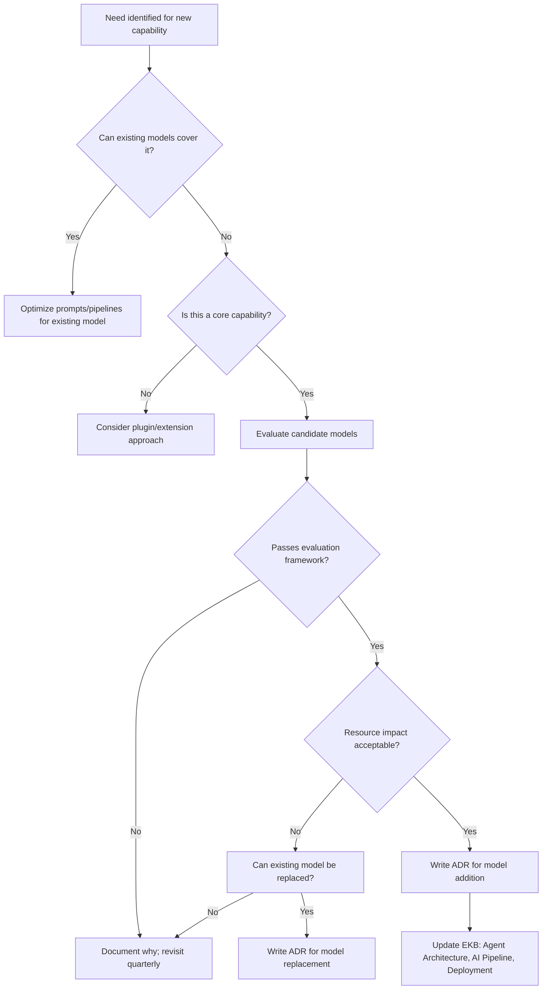
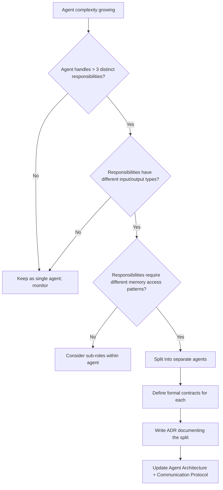
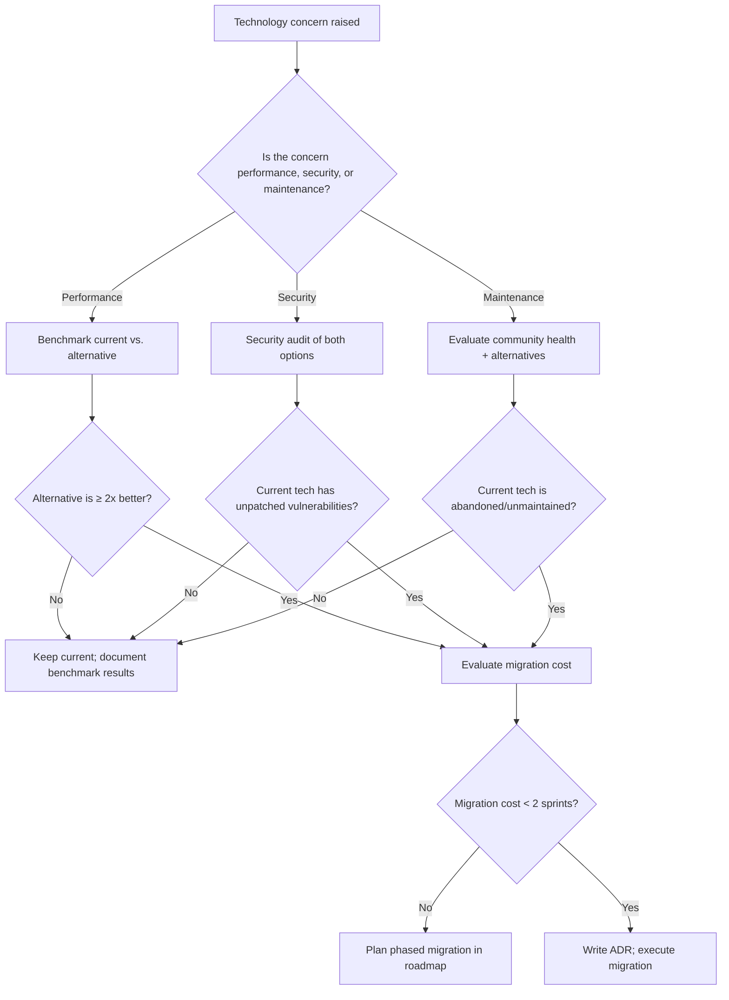
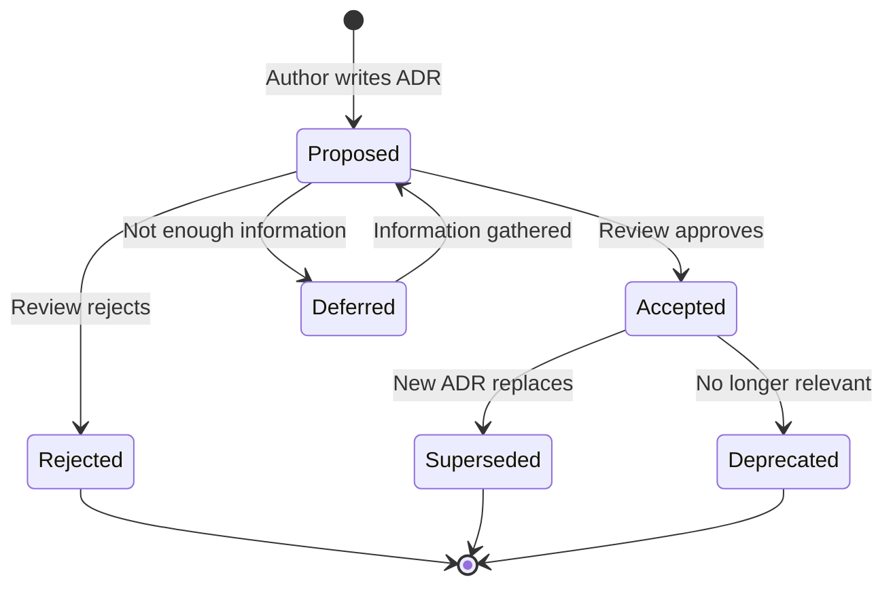

# Decision Framework

> **Version:** 1.0.0  
> **Status:** ✅ Complete  
> **Last Updated:** 2026-07-14  
> **Owner:** Architecture Team  
> **Upstream:** [Engineering Principles](engineering-principles.md), [Architecture Principles](architecture-principles.md)

---

## Purpose

This document defines **when and how** architectural, technical, and process decisions are made in Atlas. It ensures that decisions are:

1. **Consistent** — based on shared principles, not individual preference
2. **Traceable** — documented in ADRs with rationale
3. **Reversible** — understood as reversible or irreversible before committing
4. **Informed** — made with data and analysis, not gut feeling

---

## Decision Categories

| Category | Scope | Example | Required Process |
|---|---|---|---|
| **Trivial** | Single file, no architectural impact | Variable naming, log message wording | Code review approval |
| **Minor** | Single module, no cross-boundary impact | Internal data structure choice, algorithm selection | Code review + brief comment explaining "why" |
| **Significant** | Cross-module or cross-boundary impact | New event type, new API endpoint, new tool | ADR (lightweight) + architecture review |
| **Major** | System-wide or irreversible impact | New bounded context, technology change, model swap | ADR (full) + architecture board review + EKB update |
| **Critical** | Foundational change | Architecture pattern change, principle violation, security model change | ADR (full) + all-team review + EKB update + governance approval |

---

## Decision Triggers

### When to Introduce a New AI Model



**Criteria for adding a model:**
- Demonstrates ≥ 20% improvement on target task over existing models (measured by evaluation framework)
- Resource impact (RAM, VRAM, disk) does not exceed 50% increase
- Does not degrade performance of existing models
- Supports the same deployment targets (local, Docker)
- Has an active maintenance community or commercial support

---

### When to Split an Agent



**Criteria for splitting:**
- The agent's contract has grown to consume/produce > 5 distinct data types
- The agent requires > 2 different tool categories
- Testing the agent requires > 3 distinct test scenarios per responsibility
- The agent's prompt exceeds effective context window when fully specified

---

### When to Replace a Technology



**Criteria for replacement:**
- Replacement must pass the [Technology Selection Framework](technology-selection-framework.md)
- Migration plan must be documented
- Rollback plan must exist
- All existing tests must pass with the replacement
- No feature regression is acceptable

---

### When an Architecture Change Is Allowed

| Change Type | Allowed When | Requires |
|---|---|---|
| Adding a new adapter | Any time | Code review |
| Adding a new event type | The event represents a real domain event, not a workaround | Lightweight ADR |
| Adding a new bounded context | Existing contexts cannot cleanly own the new responsibility | Full ADR + EKB update |
| Modifying a port interface | The change is backward-compatible OR a migration path is documented | Full ADR |
| Changing communication pattern (sync → async or vice versa) | Performance data justifies the change | Full ADR + architecture review |
| Violating an architecture principle | Never without full ADR, all-team review, and governance approval | Critical ADR |

---

### When a PR Is Rejected

A PR must be rejected if ANY of the following are true:

| Reason | Principle Violated |
|---|---|
| Introduces an external network call in core functionality | EP-01: Local-First |
| A component takes on a responsibility outside its contract | EP-02: Specialization |
| An agent action is not logged or traceable | EP-03: Transparency |
| Code is shipped without tests for non-trivial behavior | EP-09: Test Everything |
| Error handling uses panics/exceptions for expected failures | AP-08: Error Handling |
| Domain layer imports an infrastructure package | AP-01: Clean Architecture |
| Shared mutable state is introduced between agents | AP-04: Agent Isolation |
| A breaking API change has no version bump | AP-10: API Versioning |
| A destructive operation lacks user confirmation | EP-05: Fail Safe |
| No description of "why" — only "what" — in the PR | EP-03: Transparency |

A PR may be rejected if:

| Reason | Principle |
|---|---|
| Code does not follow project coding standards | [Coding Standards](../05-engineering/coding-standards.md) |
| Coverage drops below threshold | EP-09 |
| Performance regression detected | Quality Gate |
| Documentation is missing for public APIs | NFR-602 |

---

## ADR Process

### When to Write an ADR

Write an ADR when the decision:
- Affects more than one bounded context
- Introduces a new technology or dependency
- Changes an established pattern
- Has alternatives that reasonable engineers would disagree about
- Is irreversible or expensive to reverse
- Will be questioned in 6 months ("why did we do this?")

### ADR Lifecycle



### ADR Review Requirements

| ADR Category | Reviewers Required | Approval Threshold |
|---|---|---|
| Lightweight | 1 senior engineer | 1 approval |
| Full | 2 senior engineers + 1 architect | 2 approvals |
| Critical | All senior engineers + architecture board | Unanimous |

---

## Trade-Off Analysis Template

When a decision involves trade-offs, document them using this structure:

```markdown
### Decision: [Name]

**Context:** [Why is this decision needed?]

**Options:**

| Option | Pros | Cons | Risk |
|---|---|---|---|
| A | ... | ... | ... |
| B | ... | ... | ... |
| C | ... | ... | ... |

**Decision:** [Which option and why]

**Consequences:**
- [What changes as a result]
- [What becomes easier]
- [What becomes harder]

**Reversibility:** [Easy / Moderate / Difficult / Irreversible]

**Review Date:** [When to revisit this decision]
```

---

## Decision Record

All significant decisions are recorded in the [ADR directory](../appendix/adr/). The index of current ADRs is maintained in the [Master Index](../00-index.md).

---

*This framework governs how decisions are made. For the principles that inform those decisions, see [Engineering Principles](engineering-principles.md) and [Architecture Principles](architecture-principles.md).*
