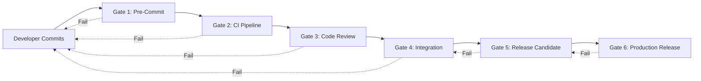

# Quality Gates

> **Version:** 1.0.0  
> **Status:** ✅ Complete  
> **Last Updated:** 2026-07-14  
> **Owner:** Architecture Team  
> **Upstream:** [Definition of Done](definition-of-done.md), [Engineering Principles](engineering-principles.md)

---

## Purpose

Quality gates are **automated and manual checkpoints** that code must pass before progressing through the development pipeline. Unlike the Definition of Done (which defines *what* must be true), Quality Gates define *where and how* enforcement happens.

A quality gate is a hard stop. If it fails, the code does not proceed.

---

## Gate Architecture

---

## Gate 1: Pre-Commit (Local, Automated)

**Trigger:** `git commit` (enforced by Git hooks)

| Check | Tool | Threshold | Blocking? |
|---|---|---|---|
| Formatting | `rustfmt`, `black`, `prettier` | Zero deviations | Yes |
| Linting | `clippy`, `ruff`, `eslint` | Zero errors, zero warnings | Yes |
| Type checking | `cargo check`, `mypy`, `tsc` | Zero errors | Yes |
| Secrets detection | `gitleaks` | Zero secrets detected | Yes |
| Commit message format | Custom hook | Follows [Commit Conventions](../05-engineering/coding-standards.md) | Yes |
| File size | Custom hook | No file > 1MB without justification | Warning |

**Bypass:** `--no-verify` (logged, flagged in code review)

---

## Gate 2: CI Pipeline (Remote, Automated)

**Trigger:** Push to any branch or PR creation

### 2a: Build

| Check | Tool | Threshold | Blocking? |
|---|---|---|---|
| Rust build | `cargo build --all-targets` | Zero errors | Yes |
| Python build | `pip install -e .` | Zero errors | Yes |
| Frontend build | `npm run build` | Zero errors | Yes |
| Dependency audit | `cargo audit`, `pip-audit`, `npm audit` | Zero critical/high vulnerabilities | Yes |

### 2b: Test

| Check | Tool | Threshold | Blocking? |
|---|---|---|---|
| Unit tests | `cargo test`, `pytest`, `jest` | 100% pass | Yes |
| Integration tests | Framework-specific | 100% pass | Yes |
| Code coverage (Rust) | `cargo-tarpaulin` | ≥ 80% on modified files | Yes |
| Code coverage (Python) | `pytest-cov` | ≥ 80% on modified files | Yes |
| Code coverage (Frontend) | `jest --coverage` | ≥ 75% on modified files | Yes |

### 2c: Analysis

| Check | Tool | Threshold | Blocking? |
|---|---|---|---|
| Architecture fitness | Custom fitness functions | All invariants hold | Yes |
| Dependency direction | Build-time check | Domain → no infra imports | Yes |
| Complexity | `cargo-complexity`, `radon` | No function > 20 cyclomatic complexity | Warning |
| Dead code | `cargo-udeps`, `vulture` | No unused dependencies | Warning |
| Documentation coverage | `cargo doc`, `pdoc` | All public APIs documented | Warning |

### 2d: Cross-Platform

| Check | Matrix | Threshold | Blocking? |
|---|---|---|---|
| Windows build + test | Windows Server 2022 | All pass | Yes |
| macOS build + test | macOS 14 (ARM) | All pass | Yes |
| Linux build + test | Ubuntu 22.04 | All pass | Yes |

---

## Gate 3: Code Review (Manual + Automated)

**Trigger:** PR ready for review

### Automated Checks

| Check | Tool | Threshold | Blocking? |
|---|---|---|---|
| All Gate 2 checks pass | CI | Green | Yes |
| PR description present | GitHub/GitLab | Non-empty, explains "why" | Yes |
| No force-pushes after review | Git hooks | None detected | Yes |
| Change size | Custom | < 500 lines (or justified) | Warning |

### Manual Review Checklist

| Check | Reviewer Verifies |
|---|---|
| Correctness | Code does what the PR says it does |
| Architecture compliance | Follows [Architecture Principles](architecture-principles.md) |
| Security | No vulnerabilities introduced, sandbox respected |
| Error handling | Failures are handled gracefully, not swallowed |
| Naming | Variables, functions, types follow conventions |
| Testing | Tests cover the right behaviors, not just lines |
| Performance | No obvious performance regressions |
| Documentation | Public APIs documented, complex logic explained |
| Principle alignment | No [Engineering Principles](engineering-principles.md) violated |

### Approval Requirements

| PR Type | Required Approvals | Special Requirements |
|---|---|---|
| Bug fix | 1 | — |
| Feature | 1 + domain expert (if applicable) | — |
| Architecture change | 2 + architect | ADR required |
| Security change | 2 + security engineer | Security review required |
| Cross-boundary change | 2 + context owner for each boundary | — |
| Principle exception | All senior engineers | Critical ADR required |

---

## Gate 4: Integration (Automated)

**Trigger:** PR merged to `main`

| Check | Tool | Threshold | Blocking? |
|---|---|---|---|
| Full integration test suite | CI | 100% pass | Yes (blocks next release) |
| Agent simulation tests | Custom framework | 100% pass | Yes |
| End-to-end task flows | Custom framework | ≥ 95% pass | Yes |
| Performance benchmarks | Custom | No regression > 5% | Warning |
| Memory leak detection | `valgrind` / `heaptrack` | Zero leaks | Yes |
| Database migration test | Migration framework | Clean up/down | Yes |

---

## Gate 5: Release Candidate (Automated + Manual)

**Trigger:** Release branch cut

### Automated

| Check | Tool | Threshold | Blocking? |
|---|---|---|---|
| Full test suite (all platforms) | CI matrix | 100% pass | Yes |
| Performance benchmark suite | Custom | Within defined targets | Yes |
| Security scan | SAST/DAST tools | Zero critical/high findings | Yes |
| Dependency vulnerability scan | All auditors | Zero critical vulnerabilities | Yes |
| License compliance | `cargo-about`, `pip-licenses` | All licenses compatible | Yes |
| Binary size | Custom | < defined threshold | Warning |

### Manual

| Check | Responsibility | Criteria |
|---|---|---|
| Smoke test on clean install | QA | Install from scratch on all three OSes |
| Upgrade test | QA | Upgrade from previous version, verify data migration |
| Rollback test | QA | Downgrade to previous version, verify no data loss |
| User acceptance test | Product owner | Key user flows work correctly |
| Documentation review | Doc owner | All docs current, no broken links |

---

## Gate 6: Production Release (Manual)

**Trigger:** Release candidate passes all Gate 5 checks

| Check | Responsibility | Criteria |
|---|---|---|
| Release notes published | Product owner | Accurate, complete, user-friendly |
| CHANGELOG updated | Developer | Follows keep-a-changelog format |
| Distribution packages built | CI | All platform packages ready |
| Announcement prepared | Product owner | Blog post, community notification |
| Monitoring verified | DevOps | All dashboards and alerts active |
| Rollback plan verified | DevOps | Can rollback within 15 minutes |

### Release Approval

| Release Type | Approvers |
|---|---|
| Patch (x.y.Z) | 1 engineer + CI green |
| Minor (x.Y.0) | 1 engineer + product owner + CI green |
| Major (X.0.0) | Architecture board + product owner + CI green |

---

## Architecture Quality Gate

**Trigger:** Any PR that changes architecture (new bounded context, new event, port interface change)

| Check | Method | Criteria |
|---|---|---|
| ADR written | PR includes ADR file | Must reference affected principles |
| Architecture fitness functions pass | Automated | All invariants hold |
| Bounded context map updated | Manual review | Diagram reflects reality |
| EKB updated | Manual review | All affected documents updated |
| Cross-context impact analyzed | PR description | Dependencies and impacts documented |

---

## Gate Metrics & Reporting

### Tracked Metrics

| Metric | Purpose | Alert Threshold |
|---|---|---|
| Gate pass rate (per gate) | Gate effectiveness | < 90% |
| Average time per gate | Development velocity | > 2x baseline |
| False positive rate | Gate accuracy | > 5% |
| Bypass rate | Discipline | > 1% |
| Flaky test rate | Test reliability | > 2% |

### Gate Health Dashboard

All gate metrics are tracked in the observability system and displayed on a development health dashboard. Trends are reviewed in sprint retrospectives.

---

*Quality gates enforce standards. For what those standards are, see [Definition of Done](definition-of-done.md) and [Coding Standards](../05-engineering/coding-standards.md). For the principles they enforce, see [Engineering Principles](engineering-principles.md).*
