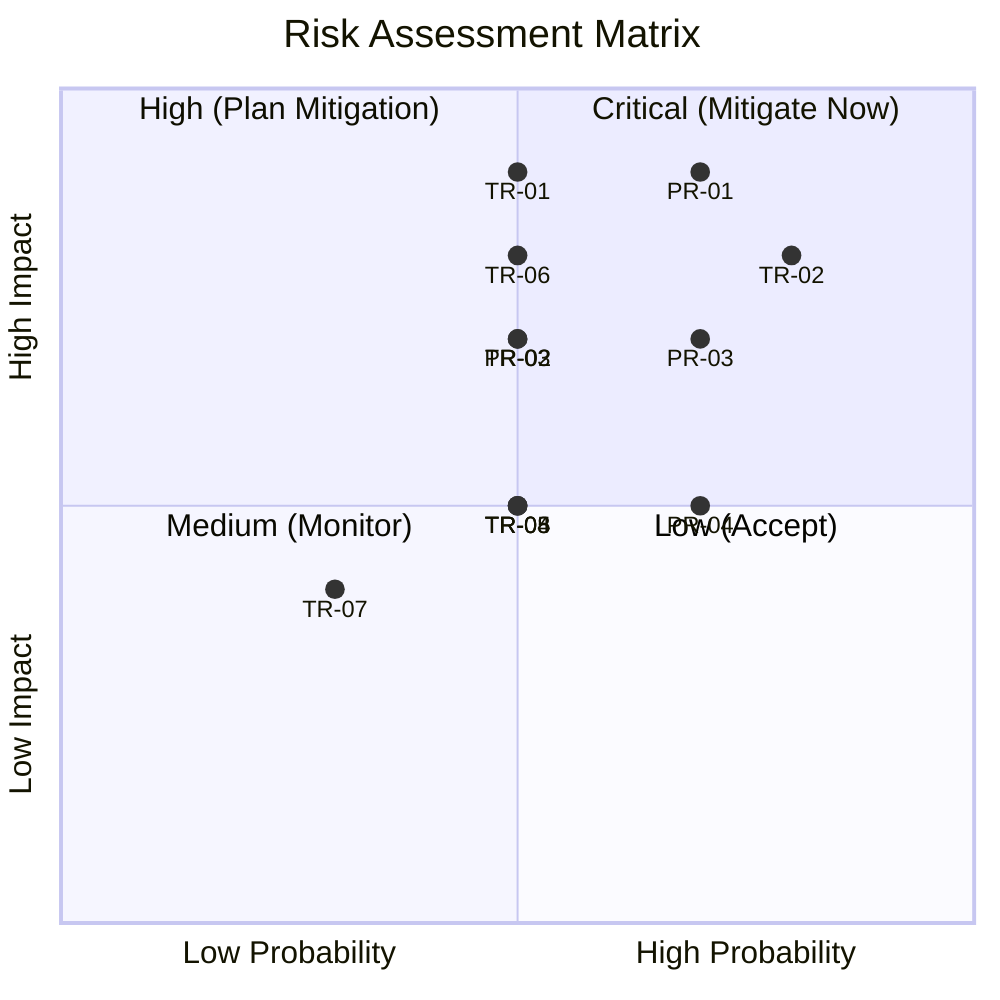

# Risk Register

> **Version:** 1.0.0  
> **Status:** ✅ Complete  
> **Last Updated:** 2026-07-14  
> **Owner:** Architecture Team  
> **Review Cadence:** Monthly  
> **Upstream:** [PRD Risk Analysis](../02-prd/prd.md#risk-analysis)

---

## Purpose

This is the living register of all identified risks to the Atlas project. Each risk is assessed for probability, impact, and mitigation status. Risks are reviewed monthly and updated as the project evolves.

---

## Risk Assessment Matrix

---

## Technical Risks

### TR-01: Model Quality Insufficient for Production Code

| Attribute | Value |
|---|---|
| **Probability** | Medium (0.5) |
| **Impact** | Critical (0.9) |
| **Category** | AI Quality |
| **Owner** | AI Team |
| **Status** | 🟡 Mitigation in progress |

**Description:** Qwen3-Coder may not consistently produce production-quality code, especially for complex multi-file features, edge cases, or less common languages/frameworks.

**Root Cause:** Local models (even large ones) have lower capability ceilings than cloud models (GPT-4, Claude). Quantization further reduces quality.

**Mitigation:**
1. **Evaluation framework** — Continuous benchmarking against known-good outputs (see [Evaluation](../09-ai/evaluation.md))
2. **Multi-stage review** — DeepSeek R1 reviews all Qwen3-Coder output before delivery
3. **Model adapter pattern** — Architecture supports swapping to better models as they become available
4. **Prompt optimization** — Dedicated prompt engineering effort per agent role
5. **Human-in-the-loop** — User approval before any code is committed

**Contingency:** If quality is unacceptable, the system falls back to "assistant mode" where it suggests rather than implements.

**Review Date:** Monthly

---

### TR-02: GPU Memory Insufficient for Three Models

| Attribute | Value |
|---|---|
| **Probability** | High (0.8) |
| **Impact** | High (0.8) |
| **Category** | Resource |
| **Owner** | Platform Team |
| **Status** | 🟡 Mitigation in progress |

**Description:** Running Qwen3-Coder + DeepSeek R1 + BGE-M3 simultaneously may exceed available GPU memory on consumer hardware (8-16 GB VRAM).

**Root Cause:** Large language models require significant VRAM. Three models simultaneously could require 24+ GB VRAM unquantized.

**Mitigation:**
1. **Model swapping** — Only load the active model; unload idle models (orchestrator manages)
2. **Quantization tiers** — Support GGUF Q4/Q5/Q8 for different hardware capabilities
3. **BGE-M3 on CPU** — Embedding model is small enough to run efficiently on CPU
4. **Hardware profiles** — Detect available resources and auto-configure (e.g., "8GB mode," "16GB mode," "24GB+ mode")
5. **Offloading** — Partial GPU/CPU split for large models

**Contingency:** Single-model mode with DeepSeek R1 handling both reasoning and simple code generation. Quality degrades but system remains functional.

**Review Date:** Monthly

---

### TR-03: Multi-Agent Coordination Deadlocks

| Attribute | Value |
|---|---|
| **Probability** | Medium (0.5) |
| **Impact** | High (0.7) |
| **Category** | Architecture |
| **Owner** | Platform Team |
| **Status** | 🟢 Mitigated by design |

**Description:** Agents waiting for each other's output could create circular dependencies or deadlocks, halting task execution.

**Mitigation:**
1. **Execution engine state machine** — All task states are explicitly defined with timeout-based transitions (see [Execution Engine](../03-architecture/execution-engine.md))
2. **Dependency DAG** — Task decomposition produces a DAG; cycles are detected and rejected at planning time
3. **Timeout-based deadlock detection** — If an agent doesn't produce output within its SLA, the orchestrator triggers recovery
4. **Heartbeat monitoring** — Agents send heartbeats; missed heartbeats trigger investigation
5. **Circuit breaker pattern** — If an agent fails repeatedly, it is temporarily removed from the pool

**Review Date:** Quarterly

---

### TR-04: Repository Indexing Too Slow for Large Repositories

| Attribute | Value |
|---|---|
| **Probability** | Medium (0.5) |
| **Impact** | Medium (0.5) |
| **Category** | Performance |
| **Owner** | AI Team |
| **Status** | 🟢 Mitigated by design |

**Description:** Initial indexing of large repositories (50K-100K files) could take too long, degrading the first-use experience.

**Mitigation:**
1. **Incremental indexing** — Only index changed files after initial setup
2. **Priority-based indexing** — Index files likely to be relevant first (recently modified, frequently accessed)
3. **Background indexing** — Indexing runs in background; system is usable with partial index
4. **File-watch integration** — OS file watchers trigger re-indexing on file change
5. **Exclusion patterns** — Auto-exclude `node_modules`, `.git`, `target`, `__pycache__`, etc.
6. **Parallelized parsing** — Tree-sitter parsing runs on multiple threads

**Review Date:** Quarterly

---

### TR-05: Memory System Grows Unbounded

| Attribute | Value |
|---|---|
| **Probability** | Medium (0.5) |
| **Impact** | Medium (0.5) |
| **Category** | Data Management |
| **Owner** | AI Team |
| **Status** | 🟡 Mitigation planned |

**Description:** Without active management, the memory system could grow indefinitely, consuming excessive disk space and degrading retrieval quality.

**Mitigation:**
1. **Automatic pruning** — Memories older than configurable threshold with low relevance scores are archived
2. **Relevance scoring** — Each memory has a relevance score that decays over time and increases with access
3. **Storage limits** — Configurable per-project storage limits with warnings at 80%
4. **Memory compaction** — Related memories are periodically merged/summarized
5. **User control** — Users can view, edit, and delete memories

**Review Date:** Monthly

---

### TR-06: Prompt Injection via Repository Content

| Attribute | Value |
|---|---|
| **Probability** | Medium (0.5) |
| **Impact** | High (0.8) |
| **Category** | Security |
| **Owner** | Security Team |
| **Status** | 🟡 Mitigation in progress |

**Description:** Malicious content in repository files (comments, documentation, test data) could manipulate AI agent behavior through prompt injection.

**Mitigation:**
1. **Prompt/data separation** — Clear delimiters between system prompts and user/repository content
2. **Input sanitization** — Repository content is sanitized before inclusion in prompts
3. **Output validation** — Agent outputs are validated against expected formats and permissions
4. **Sandboxed execution** — All tool invocations run in restricted environments
5. **Anomaly detection** — Unusual agent behavior (unexpected tools, out-of-scope actions) triggers alerts
6. **Human approval** — Destructive or unusual actions require user confirmation

**Review Date:** Monthly

---

### TR-07: Cross-Platform Compatibility Issues

| Attribute | Value |
|---|---|
| **Probability** | Low (0.3) |
| **Impact** | Medium (0.4) |
| **Category** | Compatibility |
| **Owner** | Platform Team |
| **Status** | 🟢 Mitigated by design |

**Description:** Differences between Windows, macOS, and Linux could cause inconsistent behavior or bugs.

**Mitigation:**
1. **Tauri abstracts OS differences** for desktop
2. **CI matrix tests all three platforms** on every PR
3. **Platform-specific adapters** isolate OS-specific code
4. **Path normalization** — All file paths are normalized internally
5. **Line ending normalization** — Git handles line endings; internal processing uses consistent format

**Review Date:** Quarterly

---

### TR-08: Rust-Python Interop Complexity

| Attribute | Value |
|---|---|
| **Probability** | Medium (0.5) |
| **Impact** | Medium (0.5) |
| **Category** | Architecture |
| **Owner** | Platform Team |
| **Status** | 🟡 Mitigation planned |

**Description:** Communication between the Rust core and Python AI runtime adds complexity and potential failure points.

**Mitigation:**
1. **PyO3 for tight integration** — Rust calls Python functions directly via FFI when performance matters
2. **gRPC for loose coupling** — Services communicate via gRPC when independence matters
3. **Well-defined protocol** — All messages between Rust and Python use typed, versioned schemas
4. **Health checks** — Rust core monitors Python runtime health with heartbeats
5. **Restart capability** — Python runtime can be restarted independently without affecting the Rust core

**Review Date:** Monthly

---

## Product Risks

### PR-01: Users Don't Trust Autonomous Code Generation

| Attribute | Value |
|---|---|
| **Probability** | High (0.7) |
| **Impact** | Critical (0.9) |
| **Category** | Adoption |
| **Owner** | Product Team |
| **Status** | 🟡 Mitigation in progress |

**Mitigation:**
1. **Gradual autonomy** — Start with suggestion mode; users opt into autonomous mode as trust builds
2. **Full transparency** — Show every reasoning step, tool invocation, and decision
3. **Human-in-the-loop** — User approval at every critical checkpoint
4. **Undo everything** — Every change is reversible with one click
5. **Explanation mode** — Every generated line can be explained on demand
6. **Trust score** — Build a visible trust score based on successful task completion history

---

### PR-02: Setup Complexity Deters Users

| Attribute | Value |
|---|---|
| **Probability** | Medium (0.5) |
| **Impact** | High (0.7) |
| **Category** | UX |
| **Owner** | Product Team |
| **Status** | 🟡 Mitigation planned |

**Mitigation:**
1. **One-click installer** — Platform-specific installers (MSI, DMG, AppImage) that bundle everything
2. **Bundled Ollama** — Atlas installer includes Ollama setup
3. **Model auto-download** — First-run experience automatically downloads required models with progress UI
4. **Guided onboarding** — Step-by-step first-run wizard
5. **Hardware detection** — Automatic GPU detection and model quantization selection
6. **Quick start project** — Bundled demo project that shows Atlas in action immediately

---

### PR-03: Local Model Quality Perception vs. Cloud

| Attribute | Value |
|---|---|
| **Probability** | High (0.7) |
| **Impact** | High (0.7) |
| **Category** | Competitive |
| **Owner** | Product Team |
| **Status** | 🟡 Mitigation planned |

**Mitigation:**
1. **Multi-agent advantage** — Demonstrate that specialized local models collaborating outperform a single cloud model
2. **Benchmark publication** — Publish transparent benchmarks comparing Atlas output quality
3. **Quality focus** — The review-fix loop produces higher quality than single-pass cloud generation
4. **Memory advantage** — Show that persistent memory makes Atlas smarter over time than stateless cloud tools
5. **Optional cloud hybrid** — Future extension allows using cloud models for users who want it (privacy opt-out)

---

### PR-04: Hardware Requirements Too High

| Attribute | Value |
|---|---|
| **Probability** | High (0.7) |
| **Impact** | Medium (0.5) |
| **Category** | Accessibility |
| **Owner** | Platform Team |
| **Status** | 🟡 Mitigation planned |

**Mitigation:**
1. **Tiered experience** — Define clear hardware tiers with corresponding capabilities
2. **CPU-only mode** — Functional (but slower) without GPU
3. **Aggressive quantization** — Support Q4 models for low-VRAM GPUs
4. **Single-model mode** — Run with only one model loaded at a time
5. **Cloud offload (future)** — Optional cloud inference for users without GPU

**Hardware Tiers:**

| Tier | RAM | VRAM | Experience |
|---|---|---|---|
| **Minimum** | 8 GB | None (CPU) | Single model, basic tasks, slower |
| **Recommended** | 16 GB | 8 GB | Two models (swapping), good performance |
| **Optimal** | 32 GB | 16+ GB | All models, parallel execution, best quality |

---

## Operational Risks

### OR-01: Model Updates Break Existing Prompts

| Attribute | Value |
|---|---|
| **Probability** | Medium (0.5) |
| **Impact** | High (0.7) |
| **Category** | Maintenance |
| **Owner** | AI Team |
| **Status** | 🟡 Mitigation planned |

**Mitigation:**
1. **Prompt versioning** — Prompts are versioned and pinned to specific model versions
2. **Regression test suite** — Automated tests verify prompt effectiveness after model updates
3. **Model adapter abstraction** — Model-specific quirks are handled in adapters, not prompts
4. **Staged rollout** — Model updates go through evaluation framework before production use

---

### OR-02: Community Adoption Slower Than Expected

| Attribute | Value |
|---|---|
| **Probability** | Medium (0.5) |
| **Impact** | Medium (0.5) |
| **Category** | Growth |
| **Owner** | Product Team |
| **Status** | 🔵 Accepted |

**Mitigation:**
1. **Strong documentation** — EKB serves as both internal and external documentation
2. **Example projects** — Provide pre-built examples showing Atlas in action
3. **Video content** — Screencasts and tutorials
4. **Active community** — Discord/GitHub Discussions for support
5. **Plugin ecosystem** — Encourage community contributions through Plugin SDK

---

## Risk Review Process

1. **Monthly review** — All risks with probability or impact ≥ Medium are reviewed monthly
2. **Quarterly review** — All risks are reviewed quarterly
3. **Trigger-based review** — Any significant event (new competitor, technology change, critical bug) triggers an immediate review
4. **New risk identification** — Any team member can add a risk to the register; it is assessed at the next review

### Risk Status Legend

| Status | Meaning |
|---|---|
| 🟢 Mitigated by design | Risk is addressed by architectural decisions |
| 🟡 Mitigation in progress | Mitigation is being implemented |
| 🔵 Accepted | Risk is accepted; no further mitigation planned |
| 🔴 Unmitigated | Risk exists without adequate mitigation (action required) |

---

*This is a living document. Risks are added, updated, and retired as the project evolves. For the framework that governs risk assessment, see [Decision Framework](decision-framework.md).*
