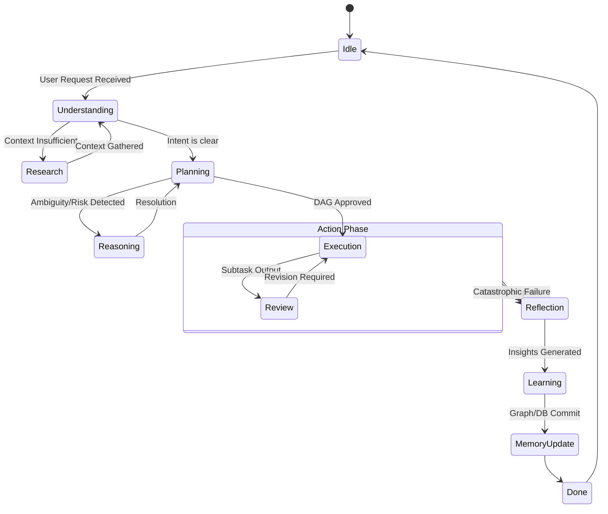

# Cognitive State Machine

> **Version:** 1.0.0  
> **Status:** 🚧 Draft  
> **Last Updated:** 2026-07-14  
> **Owner:** AI Team  
> **Upstream:** [Cognitive Architecture](cognitive-architecture.md)

---

## Objective

To define the macro-level intelligence states of the entire Atlas platform during a problem-solving session. 

*Note: This is distinct from the [Agent Lifecycle](../03-architecture/agent-lifecycle.md), which defines the OS-level process state of a single agent instance. The Cognitive State Machine describes the collective "mind" of the system.*

---

## Inputs
- User prompts, terminal interrupts, system-wide task requests.

## Outputs
- State transitions, UI progress indicators, system logs.

## Dependencies
- Event Bus (NATS), State Manager (Orchestrator).

---

## The Macro Cognitive States

---

## State Definitions

### 1. Idle
The system is monitoring the workspace for external changes via background Tree-sitter indexing, but no active goal is being pursued. RAM/VRAM are optimized (models unloaded or parked).

### 2. Understanding (DeepSeek-R1)
The system is parsing the user's intent. It attempts to map the request to known project structures. 
- **Goal:** Determine *what* the user wants.

### 3. Research (DeepSeek-R1 + BGE-M3)
Triggered when the Understanding state realizes it lacks context (e.g., "Update the payment gateway" -> "Wait, which payment gateway do we use?"). The system actively uses search tools to read code and docs.
- **Goal:** Gather the *why* and *where*.

### 4. Planning (DeepSeek-R1)
The system decomposes the understood request into a Directed Acyclic Graph (DAG) of discrete subtasks.
- **Goal:** Determine *how* to do it.

### 5. Reasoning (DeepSeek-R1)
A sub-state of Planning or Execution. Engaged when the system encounters multiple valid paths, high-risk operations (e.g., dropping a DB table), or obscure bugs.
- **Goal:** Calculate trade-offs, confidence scores, and risks. (See [Decision Engine](decision-engine.md)).

### 6. Execution (Qwen3-Coder)
The system is mutating state (writing code, running commands). This is where the Agent Lifecycle state machines run in parallel worker threads.
- **Goal:** Do the work.

### 7. Review (DeepSeek-R1)
A quality gate. Code is analyzed statically and semantically before being committed or presented to the user.
- **Goal:** Prove the work is correct.

### 8. Reflection (DeepSeek-R1)
After the work is done (or fails), the system pauses to analyze its own performance. "Did I take too many steps? Was my initial plan flawed?"
- **Goal:** Extract meta-knowledge.

### 9. Learning (DeepSeek-R1)
Converts reflections into generalized rules. "Next time we touch the DB, we must use the new migration tool."
- **Goal:** Format knowledge for retention.

### 10. Memory Update (BGE-M3 / Orchestrator)
The physical commitment of learnings into the Layered Memory System and Knowledge Graph.
- **Goal:** Persist intelligence.

---

## Failure Modes & Recovery

| Failure Mode | Recovery |
|---|---|
| **Stuck in Research** (Infinite search loop) | Hard timeout. Transition to `Reasoning` to decide if human intervention is required. |
| **Planning Paralysis** (Cannot resolve DAG) | Transition to `Idle` and request clarification from the user. |
| **Review Deadlock** (Execution and Review disagree repeatedly) | After 3 cycles, transition to `Reflection`, determine the root cause of the disagreement, and alert the user. |

---

## KPIs
- **Time-in-State Distribution:** Healthy systems spend 20% Understanding/Planning, 60% Executing, 20% Reflecting/Learning. Excessive time in Research indicates a poor Knowledge Graph.

## Extension Points
- **Custom States:** Enterprise deployments could inject an `Approval` state between Planning and Execution for strict change-management compliance.
