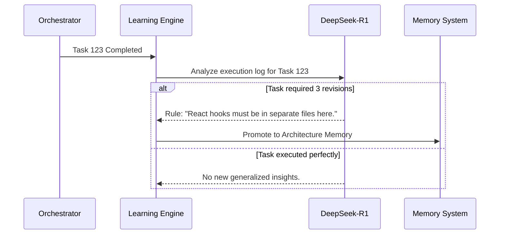

# Learning Engine

> **Version:** 1.0.0  
> **Status:** 🚧 Draft  
> **Last Updated:** 2026-07-14  
> **Owner:** AI Team  
> **Upstream:** [Cognitive Architecture](cognitive-architecture.md), [Layered Memory System](../03-architecture/memory-system.md)

---

## Objective
To enable continuous improvement without requiring fine-tuning of the model weights. The Learning Engine extracts generalized patterns from individual task successes and failures, updating the Layered Memory System so the entire platform gets smarter over time.

---

## Cognitive Contract

| Section | Specification |
|---|---|
| **Objective** | Extract reusable patterns from execution history. |
| **Inputs** | Execution Logs, Diff Artifacts, Self-Correction Reports. |
| **Outputs** | Promoted Memory Entries (Project, Architecture). |
| **Dependencies** | DeepSeek-R1 (Pattern Recognition), BGE-M3 (Memory). |
| **Failure Modes** | Over-fitting a memory (creating a rule too specific). |
| **Recovery** | Memory decay over time if not retrieved/validated. |
| **KPIs** | Same-Error Recurrence Rate (should trend to 0). |
| **Extension Points** | Federated learning (sharing memories across teams). |

---

## The Learning Loop

The Learning Engine runs asynchronously as a background task. It is triggered when a task transitions to `Completed` (Success) or `Archived` (Catastrophic Failure).

---

## Pattern Extraction (DeepSeek-R1)

To extract patterns, the Learning Engine uses a strict few-shot prompt forcing DeepSeek-R1 to generalize:

**Input:**
*Context:* Agent failed 2 times trying to use `require('path')` before realizing the project is ESM and needs `import path from 'path'`.

**Output Extraction:**
1. **Specific Fact:** "This file uses ESM."
2. **Generalized Rule:** "All new TypeScript files in this project must use ES Module syntax (`import`/`export`), not CommonJS."

---

## Memory Consolidation

If Atlas learns 50 new facts a day, injecting them all into the context window will cause an overflow.

Every night (or during periods of `Idle` state), the Learning Engine runs a **Consolidation Job**:
1. Fetches all new Task Memories from the last 24 hours.
2. Groups them by semantic similarity using BGE-M3.
3. Prompts DeepSeek-R1 to merge them.
   *Example:* Merges "Use `logger.info` in Auth", "Use `logger.info` in DB", and "Use `logger.info` in API" into a single Architecture Memory: "Always use the custom `logger.info` singleton instead of `console.log`."

---

## Traceability
- Updates the highest layers of the [Layered Memory System](../03-architecture/memory-system.md).
- Solves failures identified by the [Self-Correction Engine](self-correction-engine.md).
