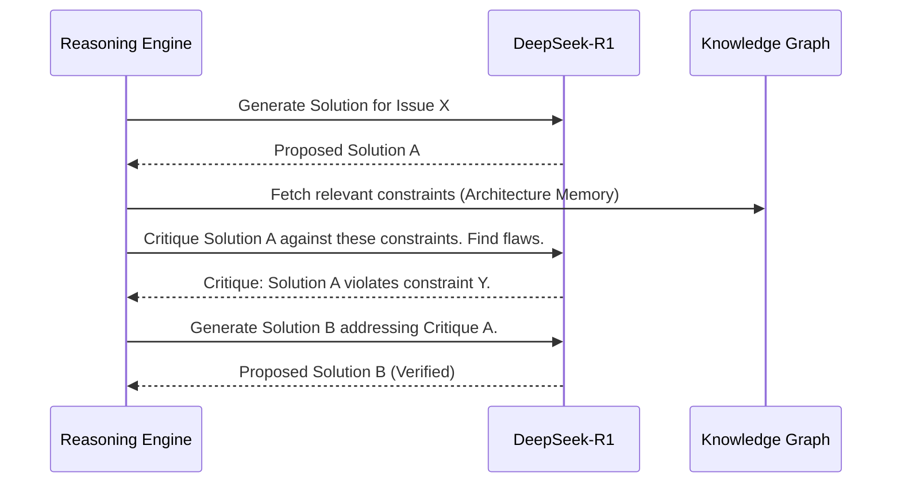

# Reasoning Engine

> **Version:** 1.0.0  
> **Status:** 🚧 Draft  
> **Last Updated:** 2026-07-14  
> **Owner:** AI Team  
> **Upstream:** [Cognitive Architecture](cognitive-architecture.md)

---

## Objective
To define how Atlas utilizes DeepSeek-R1 to perform non-linear, multi-step logical deduction, generate alternatives, and verify its own logic before committing to action. The Reasoning Engine prevents the system from blindly executing the first idea it generates.

---

## Cognitive Contract

| Section | Specification |
|---|---|
| **Objective** | Produce verified, logically sound conclusions from ambiguous inputs. |
| **Inputs** | Raw User Requests, System State, RAG Context, Tool Outputs. |
| **Outputs** | Verified Logic Paths, Hypothesis Sets, Confidence Scores. |
| **Dependencies** | Context Engine, DeepSeek-R1 inference endpoint. |
| **Failure Modes** | Logic loops, false positives in verification, context overflow. |
| **Recovery** | Hard limits on reasoning depth; fallback to human escalation. |
| **KPIs** | Decision Accuracy (%), Time-to-Conclusion (ms). |
| **Extension Points** | Pluggable verification strategies (e.g., formal provers). |

---

## The Chain of Reasoning

Unlike a standard LLM call, the Reasoning Engine forces DeepSeek-R1 into a structured, multi-step internal monologue.

### 1. Divergent Generation (Hypothesis Phase)
When presented with a problem (e.g., "The API is slow"), the engine does not immediately output a fix. It generates a minimum of 3 mutually exclusive hypotheses:
- *H1:* Database missing index.
- *H2:* Network latency to third-party provider.
- *H3:* Inefficient N+1 query in the ORM.

### 2. Evidence Gathering
The Reasoning Engine requests specific context from the Context Engine for each hypothesis (e.g., "Get the schema for H1," "Get the ORM trace for H3").

### 3. Convergent Selection (Verification Phase)
The engine evaluates the evidence against the hypotheses, eliminating the incorrect ones. This is known as **Self-Verification**.

---

## Self-Verification Mechanisms

Atlas does not trust the LLM's first output. It uses the LLM to verify the LLM.



### Prompt-Level Enforcement
The system prompt for the Reasoning Engine forces explicit XML tags for its internal state:
```xml
<thought_process>
  <hypothesis>...</hypothesis>
  <evidence_required>...</evidence_required>
  <evaluation>...</evaluation>
  <conclusion>...</conclusion>
</thought_process>
<final_output>...</final_output>
```
The Orchestrator strips the `<thought_process>` before passing the `<final_output>` to the Execution Engine, but logs it for the Cognitive Traceability Model.

---

## Failure Detection

The Reasoning Engine monitors the `<thought_process>` tags for linguistic markers of failure:
- **Circular Logic Detection:** If the output contains repeating semantic patterns across 3 iterations (e.g., alternating between fixing A by breaking B, then fixing B by breaking A), the engine halts.
- **Confidence Drop:** If the model outputs phrases like "I am not sure," "It might be," or "Perhaps," the engine lowers the internal confidence score. If it falls below a threshold, it routes to the [Decision Engine](decision-engine.md) for human escalation.

---

## Traceability
- Implements the "System 2" loops defined in [Cognitive Architecture](cognitive-architecture.md).
- Drives the logic evaluated by the [Decision Engine](decision-engine.md).
