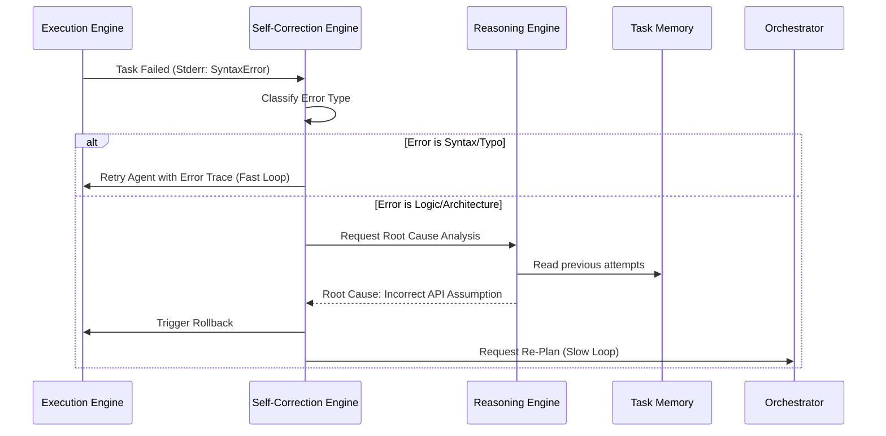

# Self-Correction Engine

> **Version:** 1.0.0  
> **Status:** 🚧 Draft  
> **Last Updated:** 2026-07-14  
> **Owner:** AI Team  
> **Upstream:** [Decision Engine](decision-engine.md), [Execution Engine](../03-architecture/execution-engine.md)

---

## Objective
To provide autonomous recovery mechanisms when execution fails. The Self-Correction Engine differentiates Atlas from a chatbot by allowing it to detect its own errors, perform root-cause analysis, and replan without user intervention.

---

## Cognitive Contract

| Section | Specification |
|---|---|
| **Objective** | Recover from execution, logic, or environmental failures. |
| **Inputs** | Error Logs, Test Outputs, Failed Output Diffs, Tool Results. |
| **Outputs** | Corrected Prompts, Replanning Requests, Rollback Commands. |
| **Dependencies** | Reasoning Engine, Rollback Manager (Execution Engine). |
| **Failure Modes** | Infinite retry loops, cascading failures from bad fixes. |
| **Recovery** | Circuit breakers on retry counts; revert to last known good state. |
| **KPIs** | Autonomous Recovery Rate (%), Mean Time to Recovery (MTTR). |
| **Extension Points** | Custom error parsers for specific frameworks. |

---

## The Recovery Loop

When a subtask fails (e.g., a test fails, or a compiler throws an error), the `atlas.task.failed` event is caught by the Self-Correction Engine.

---

## Failure Classification

To prevent wasting DeepSeek-R1 inference time on trivial typos, the engine classifies failures before responding:

### 1. Transient / Environmental
- **Examples:** Network timeout, DB locked, rate limit.
- **Action:** Exponential backoff. Do not invoke LLM.

### 2. Syntax / Format
- **Examples:** Missing bracket, invalid JSON, compiler type error.
- **Action:** Fast Loop. Send the exact error trace back to Qwen3-Coder (System 1). "You missed a comma on line 42. Fix it."

### 3. Logical / Semantic
- **Examples:** Test assertion fails (expected 5, got 4), runtime exception.
- **Action:** Deep Loop. Send the code, the test, and the error to DeepSeek-R1 (System 2). "Why did this logic fail?"

### 4. Architectural / Dependency
- **Examples:** Circular import, library version mismatch.
- **Action:** Re-Plan. Rollback the entire task and send to the Planning Engine.

---

## Root-Cause Analysis (RCA)

When dealing with Logical failures, the Self-Correction Engine forces the Reasoning Engine into an RCA prompt structure:

1. **Observe:** "The function `calculateTotal` returned NaN."
2. **Trace:** "The inputs were `price: 10`, `tax: undefined`."
3. **Identify:** "The code attempts to multiply `10 * undefined`."
4. **Solve:** "Add a default parameter or null check for `tax`."

---

## Circuit Breakers

To prevent infinite loops where an agent writes a bug, fixes it, introduces a new bug, and repeats forever:

- **Max Retries per Subtask:** Default 3.
- **Identical Error Hash:** If the exact same error string occurs twice in a row, the Fast Loop is bypassed, and it immediately escalates to the Deep Loop.
- **Failure Threshold:** If 3 subtasks in a row fail and require deep recovery, the entire DAG is halted, rolled back, and escalated to the User.

---

## Traceability
- Operates on failures generated by the [Execution Engine](../03-architecture/execution-engine.md).
- Utilizes the [Reasoning Engine](reasoning-engine.md) for deep root-cause analysis.
