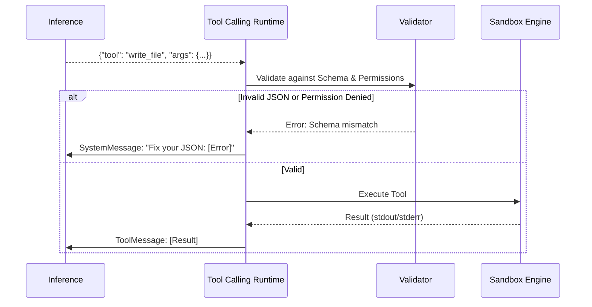

# Tool Calling Runtime

> **Version:** 1.0.0  
> **Status:** 🚧 Draft  
> **Last Updated:** 2026-07-14  
> **Owner:** AI Team  
> **Upstream:** [Prompt Runtime](prompt-runtime.md), [Execution Engine](../03-architecture/execution-engine.md)

---

## Objective
To manage the lifecycle of an LLM's tool invocation—from the moment the model hallucinates a JSON payload to the moment the physical sandbox returns stdout. The runtime handles validation, execution, and formatting the result back for the LLM.

---

## Cognitive Contract

| Section | Specification |
|---|---|
| **Objective** | Safely execute agent tool requests. |
| **Inputs** | Raw LLM output (tool request JSON). |
| **Outputs** | Tool Execution Result (stdout, stderr, exit code). |
| **Dependencies** | Sandbox Manager (Execution Engine), JSON Schema Validator. |
| **Failure Modes** | LLM outputs invalid JSON, Tool timeouts, Sandbox breaches. |
| **Recovery** | Intercept errors and feed them back to the LLM for correction. |
| **KPIs** | Tool Parse Success Rate (%), Tool Latency. |
| **Extension Points** | Plugin capability registry for custom tools. |

---

## The Tool Execution Pipeline

---

## Capability Registry

Tools are not hardcoded. The system maintains a `Capability Registry`. When an agent is initialized, the Prompt Runtime queries the registry based on the Agent's Contract (`Allowed Tools`).

**Standard Tools:**
- `read_file(path, start_line, end_line)`
- `write_file(path, content, overwrite)`
- `replace_content(path, target, replacement)`
- `run_command(cmd, cwd)`
- `semantic_search(query, layer)`
- `get_symbol_definition(symbol_name)`

---

## Result Validation & Formatting

LLMs struggle to read massive blocks of stdout (e.g., a 10,000-line `npm install` log). The Tool Calling Runtime intercepts the raw sandbox output and formats it:
1. **Truncation:** If stdout > 2000 tokens, it keeps the first 500 and last 1500 tokens (where errors usually live).
2. **Error Highlighting:** Uses Regex to wrap `Error:` or `Exception:` blocks in XML tags so the LLM pays more attention to them.
3. **Exit Codes:** Explicitly injects the exit code so the agent knows if the command succeeded without parsing the text.

---

## Retry and Rollback

If a tool (like `run_command`) fails with a non-zero exit code, the runtime does **not** trigger a systemic failure. It simply returns the error to the agent, allowing the agent's internal loop to self-correct.

However, if the tool execution causes a catastrophic sandbox failure (e.g., deleted a critical system directory by bypassing a check), the [Self-Correction Engine](self-correction-engine.md) intercepts it and triggers a Workspace Rollback.

---

## Traceability
- Links the AI generation output back to the [Execution Engine](../03-architecture/execution-engine.md).
- Emits the `atlas.agent.tool_req` and `atlas.agent.tool_res` events defined in the [Communication Protocol](../03-architecture/communication-protocol.md).
